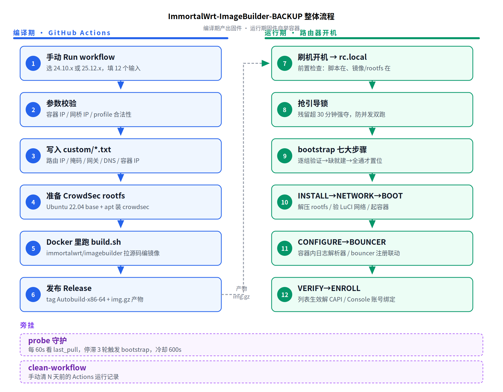
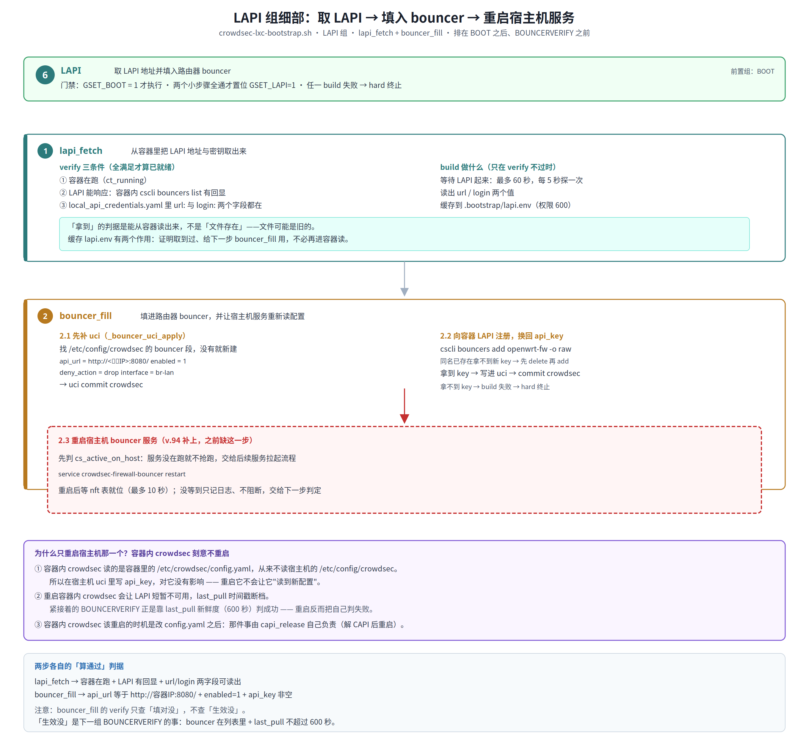
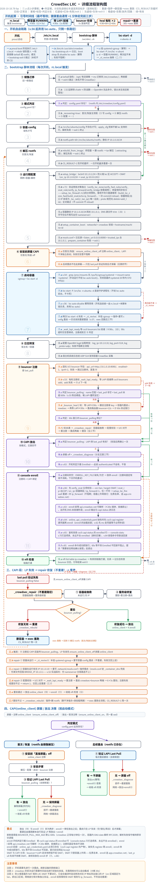

# 这是什么


# 整体流程



这个仓库分两段：**编译期**在 GitHub Actions 上把固件编出来，**运行期**固件开机后自己把 CrowdSec 容器拉起来。两段之间唯一的交接物是 `img.gz`。

## 一、编译期（GitHub Actions）

全部手动触发，没有任何 `on: push`。本仓库只有一个构建入口 `build-x86-64-24.10.x.yml`。25.12 已是独立仓库 `ImmortalWrt-ImageBuilder-25.12`，两边代码同源，区别只在包管理器（opkg / apk）与 LuCI 版本。

**① 手动 Run workflow**
在 Actions 页面选一个入口点 Run，填 10 项输入。
Docker、LXC、CrowdSec 容器都已锁定为内置（纯 X86 平台，没有「要不要 docker」也没有「要不要 crowdsec」的开关）。关键几项：

| 输入 | 说明 |
|---|---|
| `Router IP` | 旁路由管理地址，默认 `10.0.0.201` |
| `Profile` | 软件包空间，选 2G/3G/4G/10G（1G 已在选项中移除：装不下容器 rootfs） |
| `Container IP` / `Bridge IP` | 容器固定 IP 与 lxcbr0 网桥 IP，必须同 /24 |

**② 参数校验**
`Validate Crowdsec Build Parameters` 这一步很关键，它把不合法的输入挡在编译之前：

- `Profile` 小于 2G → **直接构建失败**（v.107.7 起不再「自动跳过容器构建」。跳过等于变相的不内置，会造出一个「填了 Router IP 却不生效」的固件）
- 没填 `Crowdsec Enroll Key` → 只跳过控制台账号绑定，本地 bouncer/LAPI 照常工作
- 容器 IP / 网桥 IP 做四段合法性校验、同 /24 校验、不能相同校验，任一不过就回退默认 `10.1.0.10` / `10.1.0.1` 并打 error

**③ 写入 custom/*.txt**
把路由 IP、掩码、网关、DNS、容器 IP、网桥 IP 逐个落成 `/workspace/custom/*.txt`。这些文件随后被挂载进镜像的 `/etc/config/`，固件里就有了可读的配置源。

**④ 准备 CrowdSec rootfs**
`prepare-crowdsec-rootfs.sh` 拉 Ubuntu 22.04 base rootfs，在 chroot 里 `apt-get install crowdsec`，清理 apt 缓存后打成 `files/etc/crowdsec/lxc-ubuntu.tar.gz`。这个 tar 就是固件里预置的容器镜像——**不需要联网拉镜像**。

**⑤ Docker 里跑 build.sh**
用 `immortalwrt/imagebuilder:x86-64-openwrt-<luci版本>` 官方镜像，把 `bin` / `files` / `custom` / `shell` / `.config` / `build24.sh` 全部挂载进去，跑 `build.sh`。脚本拉 feeds、装软件包、必要时下 clash/mihomo 内核，最后 `make image` 出 `*squashfs-combined-efi.img.gz`。

**⑥ 发布 Release**
产物传到 tag `Autobuild-x86-64` 的 Release，同时作为 artifact 留档。Release 说明里写后台地址/账号密码。

## 二、运行期（路由器开机）

固件刷进去开机后，`/etc/rc.local` 是唯一入口，它自己只做两件事：前置检查、抢锁。真正干活的是 `crowdsec-lxc-bootstrap.sh`。

**⑦ rc.local 前置检查**
脚本不在位、或者既没有镜像也没有 rootfs，直接跳过本轮引导——不在半残状态上瞎折腾。

**⑧ 抢引导锁**
`mkdir` 原子锁。残留锁（mtime 超 30 分钟，被 kill -9 或断电留下）会被强夺后继续，避免"一次异常永久不再引导"。锁在，说明上一次还在跑，本次跳过。

**⑨ bootstrap 九组链式置位**
按 `NETBASE → INSTALL → PREP → CAPIBLOCK → BOOT → LOGCONF → LAPI → BOUNCERVERIFY → ENROLL`（`GROUP_SEQ` 定序）执行，每组开跑前校验所有前置组已置位。组内每个节点都是**先验证现场、达标就零写入、不达标才构建**。构建失败分两种处置：结构性节点（`_structurally_broken`）失败直接整机重装，软节点（`bouncer_verify` / `enroll`）失败只记 failed 继续跑。复核统一放在 flush 之后与开机后，**不在 build 后即时复核**。

**⑩ NETBASE（13 节点）**
网络基线 11 项：`br_lan_ports` `lan_static` `dhcp_ignore` `bridge` `lxc_zone` `fwd_rules` `lan_input` `snat` `ip_forward` `svc_bind` `docker_fw`；`pkg_base` / `lxc_auto` 负责缺包时从 `/rom` 本地装回（不联网）—— `pkg_base` 另带 `luci-app-smartdns` 界面：只在这台固件编过它、运行时又缺时才补，补不上不影响引导。（v.180.157 起 smartdns 整块——配置 / 服务 / 验证——已移出本脚本，交给 `pkg-restore-smartdns.sh` 与探针。）

**⑪ INSTALL / PREP / CAPIBLOCK / BOOT**
`INSTALL` 三节点：迁移校验镜像、解压 rootfs、写容器 config；`PREP` 四节点：容器网络、cgroup 挂载、开机链、resolv.conf；`CAPIBLOCK` 在开机前停用 `online_client`（`config.yaml` 只在 crowdsec 启动时读一次，启动后再改等于没改）；`BOOT` 依赖 `snat`，没 SNAT 不启动，全程唯一一次开机。

**⑫ LOGCONF / LAPI / BOUNCERVERIFY / ENROLL**
宿主机日志推送 + 容器内采集解析（用标记日志验入库）、从容器内 `cscli` 取 LAPI 填入路由器 bouncer、验证 bouncer 真在拉（看 `last_pull` 新鲜度）才放开 CAPI、最后 `ENROLL` 做 Console 账号绑定 —— **全程唯一联网点**。

> **为什么 CAPIBLOCK 一定要在 BOOT 之前**：`config.yaml` / `acquis` / `resolv.conf` / 网络文件
> 都是 crowdsec 与 systemd 启动时读一次。启动后再改，不重启就不生效——流程里所有
> 「改静态配置」的步骤必须排在启动之前。

> **组间只保留真实存在的硬顺序**：`NETBASE → INSTALL → PREP → CAPIBLOCK → BOOT → LOGCONF/LAPI → BOUNCERVERIFY → ENROLL`。
> `LOGCONF` 与 `LAPI` 之间没有依赖，谁先谁后都行；把它们串成一条直线只是为了日志好读。

### 核心脚本防篡改（`crowdsec-guard.sh`）

产物是 `squashfs-combined-efi`，所以系统里有一个内核级只读的 `/rom`。核心脚本的开机原件
永远在 `/rom` 下——改不掉、删不掉；运行副本与它不一致（内容被改 / 被删 / 丢了执行位）就
从 `/rom` 拷回复原。保护范围：`crowdsec-lxc-bootstrap.sh`、`crowdsec-lxc-probe.sh`、
`crowdsec-guard.sh`、`rc.local`、`init.d/crowdsec-lxc-probe`。

三个调用点互为看门狗，任意一个还活着就能把另外几个补回来：

| 调用点 | 时机 | 为什么必须在这个位置 |
|---|---|---|
| `rc.local` | 开机、抢锁之前 | 要早于前置检查——bootstrap 被删时前置检查会直接 exit 0，那就再没机会复原 |
| `crowdsec-lxc-probe` | 每轮（60 秒） | 要早于 `probe_tick`——bootstrap 持锁时 tick 走 `lock-busy` 早退，完整性检查不能跟着停 |
| `init.d/crowdsec-lxc-probe` | 起服务前 | 服务被重启时兜一次 |

**为什么不用 `chattr +i`**：`/usr/sbin` 在 overlayfs 的合并视图里。还没 copy-up 时，chattr
的 ioctl 会打到下层 squashfs，直接 `Operation not supported`；先 copy-up 再设也能成功，
但 flag 只落在 upper 的 ext4 上，刷机重建 overlay 就丢，而且挡不住删 `/overlay/upper/...`
把上层实体整个拿掉。squashfs 的 `/rom` 反倒是内核级只读（`mount -o remount,rw` 直接失败），
拿它当基准才站得住。

**刻意不保护**：`/etc/config/*.txt`（action 注入的容器 IP / 网桥 IP / enroll key）和运行期
uci 配置。bootstrap 的 `_drop_enroll_key` 在绑定成功后会删 enroll key，纳进保护表只会被
反复"复原"回去。被改过的原文会在同目录留一份 `.user-<时间戳>` 备份，只留最近一份，不静默吞掉。

**占用有上限**：日志正常一条不写（只在复原时写一行），超过 64KB 只保留最后 200 行，
封顶后长期不再增长；`.user-*` 备份只留最近一份。所以被反复篡改也不会撑满 `/overlay`。

## 三、旁挂

**probe 守护**（`crowdsec-lxc-probe.sh`，独立 init.d 服务）
每 60 秒看容器 `last_pull`，连续 3 轮停滞就触发一次 bootstrap 修复，触发后冷却 600 秒。它和开机引导共用同一把锁，保证同一时刻只有一个 bootstrap 在跑。

**clean-workflow**
手动清 N 天前的 Actions 运行记录，防止积累太多。

---

## LAPI 组细部：取 LAPI → 填入 bouncer → 重启宿主机服务



填完 `api_key` 之后**必须重启宿主机 bouncer**（`service crowdsec-firewall-bouncer restart`），
否则进程仍持着旧 key，紧接着的 `BOUNCERVERIFY` 会白等 60 秒再判 hard。

同时**刻意不重启容器内 crowdsec**：它读的是容器里的 `config.yaml`，从不读宿主机的
`/etc/config/crowdsec`；重启它只会让 `last_pull` 断档，反而害得「60 秒新鲜度」判失败。
容器内 crowdsec 该重启的时机是改 `config.yaml` 之后 —— 那件事由 `capi_release` 自己负责。

## 旁路由版关键语义（本仓锁定，无模式开关）

- **所有物理网口**桥进 `br-lan`（无首口=WAN 划分）
- **`network.wan` / `network.wan6` 段整段删除**——不是 `disabled=1`
- `lan.ignore=1`：不跑 DHCP 服务，地址由上游分配
- 只删 WAN 段，不写 `wan.proto`、不设 `wan.device`、不碰 `lan` / `br_lan`

> **为什么必须删而不是 disable**：新版 fw4（nft）后台不认 `disabled` 标志。
> `network.wan` 段只要还在，fw4 生成规则时仍会按 `proto`/`device` 起接口、挂 WAN zone，
> 旁路由实际还是在当路由器用。判据必须是「段不存在」。
>
> 删掉后你随时可在 LuCI 重建 WAN 接口——脚本不阻止，只是下次引导会再删一次，
> 这叫旁路由语义闭环，不是跟你抢配置。

## 【验证 + 修改】：网络与防火墙配置由脚本自己校准

v.95 起，原先那 9 个「只验不写」的节点全部改为**验证 + 修改**；v.97 又补了两个漏网的
（`bridge` 表面在改、实际只建裸桥不写地址；`ip_forward` 写完不校验、读不回来也报成功）：

```
verify 通过  → 跳过（零写入、零 commit、零 reload）
verify 不符  → build 改回来 → uci commit → 按组 reload → 立即生效
build 失败   → hard 终止引导
改完复核仍不符 → hard 终止引导（不设回滚）
```

`RO_ONLY_NODES` 已清空，保留变量与分支结构只为「将来某项要退回只读时加个名字」。
覆盖的 12 个节点：`br_lan_ports` `lan_static` `dhcp_ignore` `wan_removed` `dns_domain`
`bridge` `lxc_zone` `fwd_rules` `wan_input` `lan_input` `snat` `ip_forward`；
另有 `docker_fw`（装了 dockerd 才生效）。

### 三个「假成功」是怎么被找出来的

这一类缺陷的共同特征是：**build 返回 0，但状态根本没改对**，而 `ensure` 不做
事后复核，于是没人发现，一路错到底。

| 节点 | 症状 | 后果 |
|---|---|---|
| `verify_ct_boot` | 整行被并进注释，函数在运行期不存在 | 每轮都重建容器，违背「全程只开机一次」 |
| `bridge` | 只 `ip link add` 建裸桥，不写 `network.lxc`、不配地址 | `ct_net` / 双向 ping 全链失败 |
| `ip_forward` | 写完无条件 log「已置 1」 | `/proc` 只读时 SNAT 与转发全废 |

检测手段是静态的：`tests/static_verify_first.py` 逐节点核查四条——
`verify_<node>` 存在、`build_<node>` 存在、`build_` 体内有判据（先判再写）、
`verify_` 体内没有写动作。这是唯一能廉价抓住「先写后验」的办法——
正常的「全就绪 → 零动作」流水测试永远走不到 build 分支。

### commit 与 reload 的区别，为什么必须成对

`uci commit` 只是把内存里的改动写进 `/etc/config/*`，**运行中的进程读不到**；
`reload` 才让进程重新加载配置。只 commit 不 reload 的结果就是「文件里是对的、
系统里还是不工作」——这正是旧版「只验不写」想规避的坑。v.95 直接把这个坑堵死：
写完必须 reload，并且 reload 后立刻再 verify 一遍。

| 配置面 | commit | 让它生效的动作 |
|---|---|---|
| `network` | `uci commit network` | `/etc/init.d/network reload`（含 lxcbr0 段与地址）|
| `dhcp` | `uci commit dhcp` | `/etc/init.d/dnsmasq restart`（reload 不够彻底） |
| `firewall` | `uci commit firewall` | `/etc/init.d/firewall reload`（fw4 重建整张 nft 表） |

三组各至多一次，且只在对应组被改动过时才触发；一次都没改就「零 commit、零 reload」。
reload 本身失败不判 hard（配置已落盘，下次重载仍生效），但**改完复核不过一定 hard**。

### 退出即恢复：不留半截置位

脚本有三种生命周期状态，任何一种残留在原地都会让下一次引导误判「已经做过了」：

| 类别 | 具体是什么 | 退出时怎么处理 |
|---|---|---|
| 进程内变量 | `GSET_<组>`、`_done_<节点>`、`_dirty_<节点>`、`_failed` | 全部清空，并打一条快照日志（干净退出时静默） |
| 内核态 | `/proc/sys/net/ipv4/ip_forward` | 本轮由脚本改过、且最终没写 `installed` → 还原成原值；引导成功则保留 `1` |
| 磁盘标记 | `reinstall_pending` | **刻意不清**。它就是靠"崩溃后残留"来计失败次数的，清了等于把自愈计数清零 |

#### 置位的值不是 1，是「分类 + 时间戳」（v.99）

以前所有置位都是 `=1`，于是三件事都做不到：看日志不知道「什么时候置的」、不知道
「是 verify 本来就过还是 build 改回来的」、退出时只知道个数不知道是谁。现在值是：

| 值 | 分类 | 含义 |
|---|---|---|
| `V:2026-10-20 12:07:38` | verified | 进场 verify 直接通过，**没有任何写入** |
| `B:2026-10-20 12:07:41` | built | build 真的改了一处（时间戳 = 改动时刻） |
| `R:2026-10-20 12:07:44` | ro | 在 `RO_ONLY_NODES` 里、脚本不代改，只登记待办 |

用法上等价于布尔：**非空即真，空串即假**。时间格式与 stamp 文件同构（`%F %T`，本地时区），
grep 一遍就能按天/按时段筛日志。退出时除了计数，还会打一行逐项明细：

```
[恢复] 退出时置位快照：done=29 dirty=12 gset=8 built=12（退出码 0）
[恢复] 逐项： _done_ct_boot=B:2026-10-20 12:07:41 _dirty_snat=B:2026-10-20 12:07:39 ...
[恢复] 置位已全部归零：done=0 dirty=0 gset=0 built=0
```

`built=N` 是这一版新加的判据：**「全都没动手」和「改了 12 处」是完全不同的结论**，
而两种情况下总数可能一样，光看个数分不出来。

改格式时踩到两个坑，都留在测试里了：

| 坑 | 症状 | 谁盯着 |
|---|---|---|
| `_FLAG_TS_FMT='%F %T'` 用单引号 | 脚本前面已有函数定义时，dash 把 `X='...'` 解析成「赋值 X=空 + 执行命令」→ `%T: not found`，变量是空串，时间戳静默变空白 | `probe_flag_format.sh` R8.8/R8.9（断言双引号 + source 无 stderr） |
| 某处仍用 `[ "$x" = 1 ]` 判置位 | 值变成 `V:<ts>` 后恒不相等，症状是某组莫名判「未置位」 | R8.3/R8.4 静态扫全脚本，一条都不许留 |

#### 为什么 `ip_forward` 需要一枚哨兵文件

`ip_forward` 是内核全局态：**重启会自然回 0，但不重启、只重跑脚本时它还是上次留下的 1**。
如果进场直接把读到的值当"原值"，就会把脚本自己上一次的写入误认成系统原本的状态，
于是"还原"变成"保持 1"，恢复逻辑形同虚设。

所以在 `$STATE_DIR/ip_forward.by-bootstrap` 落一枚空文件当哨兵，脚本置 1 时写下、还原成功后删掉：

| 进场读到 | 哨兵 | 判定 | 理由 |
|---|---|---|---|
| `1` | 在 | 原值按 `0` | 这个 1 是脚本上次置的、上次异常退出没还原 |
| `1` | 不在 | 原值 `1`，不动 | 是别的东西（手工 / 别的服务）设的，不归我们管 |
| `0` | 在 | 原值 `0`，顺手删哨兵 | 机器已经重启过、自己回 0 了，残留哨兵该清 |
| `0` | 不在 | 原值 `0` | 干净状态 |

引导成功（写了 `installed`）时哨兵**保留**——因为那个 1 是期望稳态，得留着让下次重跑
仍能认出"这个 1 是脚本的"。

这层逻辑由 `tests/probe_ipfwd_sentinel.sh` 单独盯着：它把整个脚本复制一份、只把
`/proc/.../ip_forward` 这一个字面量 sed 成临时文件路径，再用脚本自带的
`--only-funcs` 钩子只取函数定义去跑——**跑的是生产代码本体，一行逻辑都没抄**。
三个哨兵分支各做了一次变异验证（去掉判断 / 不落哨兵 / 还原后不删 / 快照不清残留），
每种变异都会让它报红。

> `--only-funcs` 是给测试用的出口：把脚本自身 `sed -n '1,/^main "\$@"$/p'` 截出来
> 打到 stdout 就 `exit 0`，不会落到 `main "$@"`。生产路径完全不受影响（只有显式传
> 这个参数才触发），但它让"拿本体做被测对象"这件事成为可能——否则只能把逻辑抄进测试，
> 那测的就不是生产代码了。

#### 顺带说清一件事：重跑时这些置位会不会自己回默认值

会，但**不是因为脚本归零**。`_bs_reexec` 走的是 `exec /bin/sh "$_self"`，整个进程映像
被替换，进程内变量自然全没了；真正"跨进程存活"的只有内核态 `ip_forward` 和磁盘标记
`reinstall_pending`。所以 `_bs_clear_flags` 的作用不是"防止跨启动污染"，而是：

1. 保证**同一进程内**不会有半截置位（信号中断、`rg_*` 子流程提前返回等情形）；
2. 让退出日志成为一张**收据**——打印「置位已全部归零」就真的能证明这次没留尾巴。

四个 trap 全装（`EXIT` / `INT` / `TERM` / `HUP`）。只装 `EXIT` 是不够的——dash 下
`SIGTERM` 默认直接终止进程、根本不走 `EXIT`，被 `kill` 或 SSH 断线时恢复逻辑不会执行。

信号处理里有个必须注意的细节：**调 `exit` 之前要把 `EXIT` trap 也摘掉**，否则
`exit` 会二次触发 `EXIT`，恢复逻辑跑两遍（日志里出现两条"置位快照/已归零"、`ip_forward`
被记成还原过两次）。这个坑第一版就踩到了，`tests/test_bp_reset.sh` 的 R2 专门盯着它。

顺序也有要求：**先做重装失败计数、再做恢复**。反过来的话计数会读到已被清空的
`_bs_stamped`/`_bs_st`，把一次真实失败记成成功。

#### 判「容器配置有没有被人动过」：比内容指纹，不比时间戳

`installed` 这个 stamp 文件里除了 `ver` / `ts`，还多记了两个指纹：

```
installed
ver=2026-10-20.102-bp
ts=2026-10-20 12:40:03
cfg_fp=a5f1c0dd3b7e2214          ← 容器 /etc/crowdsec 整个目录的内容指纹
parsers_fp=9c02be7741f0aa63      ← 容器 /etc/crowdsec/parsers 目录的内容指纹
```

**为什么不用「stamp 时间 vs 文件 mtime」判变更**——这个做法看起来合理，但两个方向都会错：

| 场景 | 时间判据会说 | 实际 | 后果 |
|---|---|---|---|
| `touch` 一下、重解压同版本 tar、备份还原 | 变了 | 没变 | 好机器被拖去**全量重装** |
| 同一秒内写两次、`cp -p` / `tar -p` 保留时间 | 没变 | 变了 | 改坏了**没人发现** |
| 时钟回跳、NTP 校正 | 不可信 | — | 时间单调性本身就不成立 |

时间只回答「什么时候动过」，回答不了「是不是同一个东西」。判「一不一样」只能比内容。

指纹的算法是「文件清单 + 每个文件的 sha1 再取一次摘要，取前 16 位十六进制」，
61 个文件实测 **9 ms**，开销可以忽略。三个实现细节都是踩出来的，每一个都对应一条测试：

| 坑 | 症状 | 修法 |
|---|---|---|
| 路径名参与摘要 | `find c` 出 `c/x.yaml`、`find .` 出 `./x.yaml`，同一个目录两个指纹 | 不接多路径参数：第一个参数当根 `cd` 进去，只算这一个目录 |
| `xargs` 无输入时抢 stdin | 空目录会把调用方管道吃掉 | `-r` + `</dev/null` |
| **`</dev/null` 挂整条管道末尾** | 管道每个元素都拿到这个重定向，`find` 的 stdout 被接 `/dev/null`，函数对**任何**目录都返回空集摘要 `da39a3ee5e6b4b0d` —— 不报错、不报警，永远说「没变」 | 只把重定向落在 `xargs` 上 |

最后一条是这一轮最值得记的：**它不报错，只是静默地永远给出同一个错误答案**。
所以 `_bs_content_fp` 额外规定：找不到文件、或路径不存在时**返回空串并置退出码 1**，
把「没法比」和「比出一致」区分开。空集摘要不是「没错」，是「看不出对错」。

读点是 `_stamp_cfg_changed`，接在重启态判定入口：

```sh
if _stamp_present; then
    log "[重启态] 检出 installed 标记：..."
    _stamp_cfg_changed || log "[变更] 上面这处差异说明容器配置被人/别的脚本改过；本次仍按组复核一遍"
    rg_restart_verify
```

**指纹只用来「说清楚现场」，不改变流程走向**。重启态本来就是逐组复核，配置改过与否，
要做的事完全一样（复核 → 不对就修一次 → 还不对重装）。但它必须出现在日志里——
否则同一台机器「今天开机很快、明天重装一遍」，事后没人说得清中间发生了什么。

判错的方向是刻意选过的：**宁可放过，不可冤枉**。所以这几种情况一律不判变更：

- 老 stamp 没有 `cfg_fp` / `parsers_fp` 字段（从旧版本升级上来的机器，当初就没记）；
- 字段值是 `-`（当时算不出指纹）；
- 现在也算不出指纹（容器目录被删、权限不对）——那是 `verify_rootfs` 该管的「缺东西」。

`tests/probe_stamp_fingerprint.sh` 的 R9（指纹本身 24 条）与 R10（读点 11 条）盯着这一整块，
其中 R9.7b/c 把「该场景下时间判据会说 changed、而内容判据说 same」做成可执行断言，
而不是注释里的一句话。

#### 重启态：哪个坏了修哪个，修不好才重装（v.101 修掉一个"每次开机都抹盘"的故障）

重启态的设计意图一直是「逐组复验、按需修补」，但 v.100 之前的实现是坏的，而且**完全静默**：

```sh
if "verify_$_g" 2>/dev/null; then ...     # 组名 PREP → verify_PREP
```

全脚本**没有** `verify_PREP` 这个函数（只有 `verify_br_lan_ports` 这类节点级函数）。
dash 报 `not found`，被 `2>/dev/null` 吞掉，返回非 0 ⇒ 判「内容不符」⇒ 调同样不存在的
`build_PREP` ⇒ 判「构建失败且无法修复」⇒ `full_reinstall` ⇒ **抹掉 rootfs**。

也就是说：**每次重启都会抹一次容器**，日志上看起来还挺"正常"——它老老实实打了
「构建失败且无法修复，彻底重装」。

修完之后是真正的「哪个坏了修哪个」：

```
按 GROUP_SEQ 逐组：
    这组置位了吗？没置位 → 重装（说明流程没走完，不是配置问题）
    组内逐节点（节点清单从全局 _order 按 NODE_GROUP_<节点> 筛，与 ensure_group 同口径）：
        verify_<节点> 过      → 跳过，一个字节都不写
        verify_<节点> 不过    → build_<节点> 修一次
            build 成功        → 继续下一个节点
            build 也失败      → 记下来（说明不是配置错，是环境坏了）
    本组有修不好的节点 → 重装
```

同一个提交里还修了两处同源问题：

| 问题 | 症状 |
|---|---|
| `main` 里残留 `eval "GSET_$_g=0"` | v.99 起置位值是 `V:<ts>`，`0` 是非空值 ⇒ 被判成"已置位"，后组的前置检查形同虚设 |
| 组键大小写不一致 | `GROUP_SEQ` 是大写、置位用小写，读错名字就永远读不到值（现在统一用 `_rg_key` 转小写） |

这三条都由 `tests/probe_restart_verify.sh`（R11，15 条）钉住，其中 R11.6 专门断言
「已经对的节点 `build` 一次都没被调用」——这才是"按需修补"和"无脑重写"的分界线。

#### `last_pull` 失效之后，脚本到底修什么（v.102）

`last_pull` 是 bouncer 向 LAPI 拉决策的时间戳，**只反映 bouncer↔LAPI 这条链**，与日志
转发无关。它失效后的处理在 `step_C`，四步：

```
① 等 LAPI 就绪（最多 90s）+ 直接查 last_pull      → 有效：链路就绪，收工
② LAPI 就绪但 last_pull 没刷新：再等一个纯窗口
   （12×5s=60s，只观察、不夹带任何写入/重启）      → 恢复：链路就绪，收工
③ 仍未恢复 → 复验 A/B 定位根因
④ A/B 有缺项 → 修一次 → 复验 → 再走一轮 ①+②
```

**真正会动手的只有两处**，其余都是等待和判定：

| 步骤 | 判据 | 修复动作 |
|---|---|---|
| A | 宿主机 syslog 是否转发到容器 `IP:514/udp`（`verify_log_forward` 四个 uci 值） | `setup_log_forward`：写 `log_ip/log_port/log_proto/log_remote` + `uci commit system` + reload logd |
| B | bouncer 服务活着 + nft 表就位 + （LAPI 可达时）bouncer 已注册 | `fix_B`：屏蔽 CAPI → `_bouncer_uci_apply`（api_url/enabled/deny_action/interface=br-lan）→ 等 LAPI → **`_bouncer_register_once`（删残留坏记录 → `cscli bouncers add` 拿新 key → 写进 uci）** → enable+restart 宿主机 bouncer → 等 nft 表 |

其中**最可能真正治好 `last_pull` 的是 `_bouncer_register_once`**：`last_pull` 停滞的头号
原因就是 bouncer 的 `api_key` 与 LAPI 里注册的对不上（换过容器、动过 uci、服务没重启），
重新注册换一把新 key 写回 uci，链路立刻通。A 步的日志转发其实治不了 `last_pull`，
它在这里的作用是"证明整条链路的其他部分都没塌"，用来把「容器整体坏了」和
「某个组件缺了」区分开。

修完之后的判定：

```
修好后 last_pull 恢复                        → 收工
A/B 修好了但 last_pull 仍不恢复               → 判定容器损坏 → 五道门 → 抹 rootfs 重装
A/B 修不好                                    → hard 终止（exit 1），不重装
```

> **为什么要 A/B 都正常才重装**：A/B 正常说明该配的都配了、服务都在跑，却还是拉不到
> 决策 —— 那就不是配置问题，是容器里的 crowdsec/数据库坏了，重装才对。反过来，A/B
> 有缺项时先修，因为缺项本身就可能就是原因（比如 bouncer 没注册 → 没 key → 拉不到）。

**这里有个 v.102 修掉的假绿**：`bouncer_pulling` 返回 0 有两种来路——「明确新鲜」和
「判不了」。原先判不了的三条路径（容器内 `date` 不可用、阈值非数字、阈值=0）全是裸
`return 0`，一个字不打。而 `_escalate_reinstall` 的第一句就是 `if bouncer_pulling; then … 不升级`，
于是判不了被读成「已恢复」，打出「last_pull 已恢复，重装无益」——**机器卡在坏状态，
日志一路报喜**。现在判不了仍然放过（误判失效会把好机器带去重装，破坏性更大），但
必须打一行「判不了……这不是『新鲜』」，并且 `_escalate_reinstall` 的措辞改成
「当前判定为在拉」并附一句「若上一行是判不了，这一行是放行不是确认恢复」。

顺带：阈值填成非数字时不再静默关闭检查（警告后回落默认 60s）；`_sc_wait_pull` 的
60 秒干等加了进度日志，并且同一句「停滞」不再每 5 秒刷一遍。

`tests/probe_last_pull_semantics.sh`（R12，19 条）钉住这些，其中 R12.6~R12.8 专门断言
「判不了时返回码仍是 0，但日志必须出现」——**放过可以，闭嘴不行**。

### LAN 四值以编译期文件为准

`network.lan` 的 IP / 掩码 / 网关 / DNS 四个字段，**期望值来自编译期写进固件的
四个文件**（GitHub Actions 输入框 → `/etc/config/custom_router_*.txt`），
由 `_lan_static_conf` 推导、`build_lan_static` 校准：

| 情况 | 结果 |
|---|---|
| 什么都没填 | `10.0.0.201 / 255.255.255.0 / 10.0.0.10 / 10.0.0.10` |
| 填了 IP 且掩码是 /24 | 网关与 DNS 自动取该 IP 的前三段 `.1` |
| 掩码非 /24 | **不推导**，网关仍取文件里的值（推不出来） |
| 显式填了网关 | 网关用该值；没单独填 DNS 时 DNS 跟随网关 |
| 显式填了 DNS | DNS 用该值（优先级最高） |

这意味着**在 LuCI 里改 LAN 地址会被下次开机改回去**。要改就从这四条路走：

1. 重新编译，在 Actions 里填新的 `Router IP` 等输入；
2. 或直接改 `/etc/config/custom_router_ip.txt` 等文件的首行，下次开机生效。

写入前有一道合法性闸门 `_lan_conf_valid`：IP / 网关 / DNS 必须是合法的点分四段
（每段 0–255、不允许多余前导零），且 IP 不能等于网关。**任何一项不合法就放弃写入并
hard 终止**——因为把 `network.lan` 写成非法地址，`network reload` 后接口起不来，
SSH 直接失联，而且是那种"重启也进不去"的失联。

### 需要自担的风险

把 `br-lan` 或 `lan` 地址改错，SSH 会当场失联，脚本也没法自己救回来。
因此 `build_br_lan_ports` / `build_lan_static` 前有一道 `_net_write_guard`：
它读 `SSH_CONNECTION` 判断你从哪个网段进来，如果来自 LAN 网段就明确打警告日志
（「改写后本会话可能失联」），非 LAN 网段则提示影响不到本会话。
这只是提醒，**不是拦截**——脚本仍会按你的期望值改下去。

### SNAT 是容器出网的生命线（`snat` 节点）

`snat` 归属 **PREP 组**（容器启动前），并且 **`ct_boot` 依赖它**——SNAT 没就位就不开机。
原因很直接：容器没有 SNAT 就出不了网，拉不到 LAPI，`last_pull` 一直停滞，
探针每小时判一次失败，最后走到反复重装。这不是配置洁癖，是防止自伤。

五个字段逐项核对，少一个都不放行；不符则由 `build_snat` 就地校准：

| 字段 | 期望值 |
|---|---|
| `target` | `SNAT` |
| `proto` | `all` |
| `src` | `lan` |
| `src_ip` | 由 `CONTAINER_IP` 推出的网段（如 `10.1.0.0/24`） |
| `snat_ip` | 路由器 LAN 地址（`network.lan.ipaddr`） |

**按 `name=lxc-snat` 定位段，不赌段名**：LuCI 删了重建会把段名变成 `cfg0a1b2c`
或 `@nat[0]`，写死 `firewall.lxcsnat` 会在「用户界面上明明配了」的情况下误判缺失。
这一点有专门的回归测试（S1.2 / S1.4）。重复 build 不会多造第二条 SNAT 段（S4.5）。

脚本还会写这些（按配置面）：

- `dropbear` / `ttyd` 的 `Interface`（把 SSH/Web 终端绑到 LAN 侧，各自局部 reload）
- `/etc/config/system` 的 `log_ip` / `log_port`（系统日志推给容器里的 crowdsec）
- `/etc/config/crowdsec` 的 `api_url` / `api_key`（bouncer 注册，写完重启宿主机 bouncer）

**防火墙不删整段**：全仓只允许 `uci -q delete firewall.<段>.<字段>` 这种单值删除
（如 `firewall.docker.subnet`），不允许删掉某个 zone/rule 段本身。
原来的 `build_docker_fw` 会 `uci delete firewall.docker` 并清掉所有含 docker 的
forwarding——那正是用户在 LuCI 里建的配置，现在改成「有则校准、无则补建」。

**WAN 段删除**：`build_wan_removed` 会 `uci -q delete network.wan` 与 `network.wan6`。
删完走 network 组统一 commit + reload。

**删段不波及桥接**：只删 `network.wan` / `network.wan6` 两个 section，
`br_lan`、`lan`、`ports`、`lan.device` 一概不动——这四项不动就是判据。

## 测试怎么跑

全在 `tests/` 下，纯 `sh`，无外部依赖（只有静态检查那一条要 `python3`）。

```sh
sh tests/test_bp_reset.sh            # 退出即恢复，内部转调下面 4 个探针
sh tests/probe_ipfwd_sentinel.sh     # ip_forward 哨兵（也可单独跑）
sh tests/probe_flag_format.sh        # 置位值格式「分类+时间戳」
sh tests/probe_stamp_fingerprint.sh  # 内容指纹：判「一个不一样」，不比时间
sh tests/probe_restart_verify.sh     # 重启态逐组复验：哪个坏了修哪个
python3 tests/static_verify_first.py # 逐节点核查「先验证后写入」
```

另有 19 个脚本可单独执行：`probe_v10830` ~ `probe_v10858` 一组按版本命名的回归探针
（对应各次修复）、`probe_audit` / `probe_guard` / `probe_netsafe` / `probe_lxc_auto` /
`probe_boot_heal` / `probe_boot_timeout` / `probe_dns_watch`、以及 `guard_pin` /
`guard_tests_dir` / `lapi_ladder` / `log_trim`。

每条脚本末尾自带通过数，以实际输出为准。

| 关注点 | 对应测试 |
|---|---|
| 退出路径：trap 有没有者、信号来了跑不跑、置位清没清 | `test_bp_reset.sh` |
| 判据本身错：拿 mtime 比时间当「变没变」，两个方向都会错 | `probe_stamp_fingerprint.sh` |
| 形状错：build 体内没有判据，等于无条件覆盖 | `static_verify_first.py` |
| 脚本自身被改坏 / `tests/` 目录没进镜像 | `guard_pin.sh` / `guard_tests_dir.sh` |

> v.180.162 起，`test_bp_dag.sh` / `test_bp_net.sh` / `test_bp_consistency.sh` /
> `probe_last_pull_semantics.sh` / `luci_restore.sh` 这 5 个失效测试已从 `tests/` 删除。
> 旧文档里 `sh tests/test_bp_*.sh` 那一排命令不要再照抄。

## 与双模式版（原 bk 仓）的差异

| | 本仓（旁路由版） | bk（双模式版） |
|---|---|---|
| 模式 | 仅旁路由 | gw / bypass 双模式，`custom_router_mode.txt` 切换 |
| 桥接 | 所有物理口 → br-lan | gw 模式首口=WAN，其余进桥 |
| WAN | wan/wan6 段整段删除 | gw 模式首口 dhcp 拨号 |
| DHCP | lan.ignore=1 | gw 模式 lan 正常发地址 |
| 网络/防火墙写入 | 验证 + 修改 + commit + 分组 reload | 自动补建 |

## v.103：并入 DeepSeek（大肥鱼）的 Docker/LXC 修改

master 上 DeepSeek 的提交 `daad530d` 把 Docker/LXC 改成默认安装（Actions 输入 12 → 11 项，
只剩 `Include Crowdsec` 一个开关——**该开关已于 v.107.7 删除，现在容器恒内置**），脚本本体带入 4 处修复：service 命令统一走
`/etc/init.d` 且服务名收敛到 `BOUNCER_INIT`；`verify_br_lan_ports` 两侧 `_norm_list`
归一化后比较；`re_enroll` 成功后删注册码文件；`build_ct_boot` 补 `lxc-auto` 防复发注释。
合并前逐字节核对过双方基线（同从 v.99 出发，无隐藏分叉）。`test_bp_net.sh` 同步补了
`_norm_list` 的函数提取（原清单漏项，导致沙箱里两条假失败）。合并后 `bp` 分支已删除，
仓库只剩 master。

## v.104：大肥鱼抓出重启态复核链的大小写回归（已采纳 181945e5）

大肥鱼（DeepSeek）提交 `181945e5`，指出并修掉三个缺陷，本地逐条复现后确认全部成立：

| 缺陷 | 复现证据 | 来源 |
|---|---|---|
| `rg_restart_verify` 读 `GSET_$_rg_key`（小写），置位却是 `GSET_$_g`（GROUP_SEQ 原值，大写）—— 八个组一个都读不到，每次开机第 1 组判「未置位」→ `full_reinstall` | 按生产写法置位（大写）仍触发重装 | **v.101 引入的回归** |
| `full_reinstall` 被五道门挡回（返回 1）时也 `exit 0`，「复核链整条失效」被演成成功退出 | 该场景退出码为 0 | v.93 遗留 |
| `_bs_content_fp` 用 xargs 喂文件名，按空白拆词：`a b.yaml` 被拆成两个不存在的路径、错误被 `2>/dev/null` 吞掉 | 改 `a b.yaml` 内容前后指纹相同（57208f9c），改 `c.yaml` 会变 | **v.100 的坑** |

测试侧的教训更值得记：`probe_restart_verify.sh` 的夹具自己按小写写 `GSET_prep`，
**伪造了现场** —— 测试越绿，生产越错。v.104 起夹具一律按 `ensure_group` 的写法
造状态（大写），并新增 R11.5b / R11.5c 静态断言：读取端禁止再做大小写转换、
必须读 `_rgG`。口径钉死：**组键一律用 GROUP_SEQ 原值，置位与读取两侧都不转换**。

本提交在其之上仅做版本串（`.103-bp` → `.104-bp`）与文档同步，修复内容逐字节一致
（树 `b7485ae9` 相同）。回归：739 条断言 0 失败，`dash -n` 与 `shellcheck -S error` 干净。

## v.108.8：lxc-auto 的配置文件从未进过镜像（bind mount 遮蔽）

现场证据：`cat /etc/config/lxc-auto` 出来的是 lxc-auto 包自带的注释模板

```
#config container
#	option name container1
#	option timeout 300
```

一行有效配置都没有 → `config_foreach` 遍历不到 `container` 段 →
`/etc/init.d/lxc-auto start()` 直接 return 0，什么都不做，容器开机不常驻，
而宿主日志干净得像没事。

根因在 workflow：

```yaml
-v "${{ github.workspace }}/custom:/home/build/immortalwrt/files/etc/config"
```

Docker 的 bind mount 会**整体遮蔽**挂载点目录的原有内容，而 `custom/` 在 git 里是空的
（内容由 action 运行时生成）。所以仓库里的 `files/etc/config/lxc-auto` 在构建容器里
根本不存在。它与这条挂载写在同一个提交 `181945e`（v.104）里 ——
**从引入那天起就没生效过**，之前所有「lxc-auto 服务起不来」的现场都源于此。

修法：

| 位置 | 改动 |
|---|---|
| `files/etc/config/lxc-auto` | **删除**（留着只会让人以为它进了镜像） |
| `files/etc/uci-defaults/98-lxc-auto.sh` | 新增，首启写 `container` 段（不在 `/etc/config` 下，不受挂载影响） |
| `_ensure_lxc_auto` | 恢复「能补写 + commit」（v.108.7 的「只校验」= 永远拉不起来） |
| `crowdsec-guard.sh` | `/etc/config/lxc-auto` **移出** GUARD_FILES（v.108.7 加的，撤回） |
| `build24.sh` | chmod 列表加 `98-lxc-auto.sh` |

guard 必须撤的理由：guard 的基准是 `/rom`，而 `/rom` 里就是那份注释模板，
纳进去等于「bootstrap 写一次、guard 复原一次」，容器在两次之间随机起不来。
`/etc/config/lxc-auto` 从此与 `network` / `firewall` 同性质 —— 运行期 uci 配置，不进 guard。

## v.108.9：把 lxc-auto 配置真正固化进镜像（修挂载，不是绕开挂载）

v.108.8 是绕路（运行期写）。根因是挂载本身写错了，正确做法是让它能进镜像：

| 位置 | 改动 |
|---|---|
| `files/etc/config/lxc-auto` | **恢复**，内容是 `config container` / `option name 'ubuntu'` / `option timeout '300'` |
| workflow（24.10） | `custom` 改挂到 `/home/build/immortalwrt/custom`，不再盖住 `files/etc/config` |
| `build24.sh` | 新增 `custom/*` → `files/etc/config/` 的拷贝循环，拷贝失败 `exit 1` |

Docker 的 bind mount 是「整体替换目录」而非「合并」，这正是 `files/etc/config/` 下
任何文件都会凭空消失的原因 —— 不只是 lxc-auto，将来往这里加任何配置文件都会中招。
改成挂到独立目录再拷入，注入的 `/etc/config/*.txt` 行为不变，固化的文件也不再被吃掉。

`98-lxc-auto.sh` 保留为兜底：它先判断 `option name` 是否已是 `ubuntu`，是就直接
`exit 0` 一个字都不改 —— 固化生效后它是空转的，只在镜像配置被删/被改时才补。

回归：265 条断言 0 失败（新增 R15.15c~j）。

## v.108.10：断言不能把注释当成代码

现场排查时用 `grep -c 'lxc-auto disable'` 判断「bootstrap 会不会禁用服务」，
命中了一条 —— 但那条其实是注释，于是得出「不会 disable」的错误结论，
把人引去改了一个不需要改的地方。反过来同样致命：`R15.6d` 断言
`build_cgroup_mount` 里有 `return 0`，这一条**一直是靠注释里那句
「原先无条件 return 0」在充数**，函数体里根本没有。

两类风险一句话：**注释里提到关键字，会让「期望 0」的断言假红、让「期望 ≥1」
的断言假绿。**

改法：

| 位置 | 做法 |
|---|---|
| `probe_netsafe.sh` | 生成 `BS_C`（`grep -v '^[[:space:]]*#'` 的去注释副本），37 处断言改用副本 |
| 其余 5 个 probe | 同样生成 `BS_C`，共 50 处引用改指向副本 |
| `probe_guard.sh` | 新增 `cg <file> <pattern>`，18 处针对脚本文件的断言改走 `cg` |
| 新增元断言 | R17.1~R17.3、R13.45~R13.46：确认副本机制存在且真被用上 |

改造当场揪出一条假绿断言（`R15.6d`），已按真实语义拆成两条：
`build_cgroup_mount` 透传 `return $?`，`_mount_systemd_cgroup` 在 unified 宿主跳过 v1 层。

回归：271 条断言 0 失败。

## v.108.11：全仓审计——补上「失败被当成功」的最后两条路径

审计按「验证是否验到实处」一条线走，先看结论：

| 检查项 | 结果 |
|---|---|
| 断言点名的函数在脚本里是否存在（抽不到会拿空串比） | 9 处引用，0 缺失 |
| `files/` 权限位（git 视角，不是 Windows 视角） | 6 个脚本全 100755 |
| `GUARD_FILES` 6 项与实物对账 | 全部存在 |
| 两个仓库的 workflow 挂载是否一致 | 一致（只有 config 文件名不同：imm / imm25） |
| `ensure()` 是否会被子 shell 吃掉 `exit 1` | 全部直接调用，无 `$(ensure)` / `\| ensure` |

新发现三处，都修了：

### 1. 总 flush 的失败只记录不处置（真漏洞）

`_flush_rc` 在 net-only 分支里被检查，正常路径上算完就丢，最后照样 `exit 0`。
等于 commit / reload 失败（网络、防火墙没落盘）也被当成引导成功。已改为：

```sh
if [ "$_flush_rc" != "0" ]; then
    log "配置提交/重载失败（详见上方 [flush] 行），引导按失败退出"
    exit 1
fi
```

放在 `_stamp_write` 之前 —— 没落盘就不该写 installed 标记，否则下次开机直接进「重启态复核」。

### 2. `lxc.utsname` 断言里的点号没转义

```sh
grep -c 'lxc.utsname'      # . 匹配任意字符，期望 0 时会假红
grep -c 'lxc\.utsname'     # 改为字面点
```

（`-F` 的断言不受影响，审计脚本一开始还误报了一批，已核实是误报。）

### 3. `custom/` 能覆盖固化配置

`custom/*` 的拷贝排在 `make image` 之前，谁拷谁赢。若注入里出现 `lxc-auto`，
就能把容器名改掉且现场毫无报错。两个构建脚本改为显式跳过并 `::warning::` 提示。

顺带补了 R15.15k：容器名现在有**三处**来源（bootstrap 的 `LXC_NAME` 默认值、
`98-lxc-auto.sh` 兜底、`files/etc/config/lxc-auto` 固化），断言它们收敛成一个名字，
并做过反向验证（故意改成 `ubuntux`，断言从 PASS 变 `got=[2]`）。

回归：274 条断言 0 失败。

### 仍然存在的局限（写清楚，别当已解决）

| 局限 | 影响 | 现状 |
|---|---|---|
| 7 套 probe 全是静态文本断言，沙箱里没有 uci/ip/nft，跑不了 bootstrap 真流程 | 逻辑正确性仍要靠人读 + 真机验证 | 无解，除非有可执行沙箱 |
| `ensure()` build 成功後不复核 verify | build 说自己成功就当真 | 靠 build 返回值诚实 + flush 兜底 |
| `_wait_ct_running` 只判进程存活 | 容器「RUNNING 但没 IP」会被当成功 | 可加就绪判定，但只告警不硬终止 |
| guard 只保护 6 个文件 | `/etc/config/lxc-auto` 只有名字/段缺失/注入 command 会被自愈，timeout、多余段等不归它管 | 有意为之，见 v.108.8 / v.108.12 |

## v.108.12：`_ensure_lxc_auto` 到底能修什么，以及一段可被 root 执行的配置

被问「这个是什么情况，`_ensure_lxc_auto` 可以修吗」，先把边界划清楚：

| 坏法 | 能自愈吗 | 说明 |
|---|---|---|
| 整份是注释模板（包自带） | ✅ | `uci get` 取不到段 → `add` 一段 |
| 文件被删 | ✅ | 同上 |
| `option name` 写错 / 为空 | ✅ | `set` 回 `LXC_NAME` |
| 服务被 disable | ✅ | `enable` 并回到 S99 |
| `option timeout` 写错 | ✅（v.108.13 起） | 每次都校正为 300，不再依赖 name 是否对 |
| 多出第 2、3 个 container 段 | ❌ | 只认 `@container[0]`，多余的段不归本脚本管 |
| 段类型被改成别的（`config foo 'container'`） | ⚠️ | 会 `add` 一个新段，旧垃圾段留着 |
| **段里被塞 `list command '...'`** | ✅（v.108.12 起） | 见下 |

最后一条是这次补的。`files/etc/init.d/lxc-auto` 的 `start_container()` 里写着：

```sh
config_list_foreach "$cfg" command run_command
```

也就是说段里只要出现 `list command '/tmp/x'`，`/etc/init.d/lxc-auto start` 就会**以 root 执行它**，
而且 bootstrap 自己也会调这个服务。镜像固化的容器段只有 name + timeout，
出现 `command` 一律视为被注入，`_ensure_lxc_auto` 现在会删掉并记一行日志。

只清 `@container[0]` —— 用户自己加的段（比如另一个容器）不归本脚本管。

回归：276 条断言 0 失败（新增 R15.15n、R15.15o）。

## v.108.14：旧固件留下的 `lxcboot` 兜底，谁来回收

v107-bp 那版固件的启动链是断的（`/etc/config/lxc-auto` 整份注释 + 服务 disabled），
现场只能手工建 `/etc/init.d/lxcboot` + `/etc/rc.d/S99lxcboot` 把容器拉起来。

这份兜底**不在 GUARD_FILES 里，也没有任何步骤会回收它**。后果在「保留配置」刷机时才显现：

| 现象 | 原因 |
|---|---|
| `S99lxc-auto` 与 `S99lxcboot` 同时启同一个容器 | rc.d 里两条链都还在 |
| 后跑的那次 `lxc-start` 报 already running | 抢同一容器，本身无害但日志噪声 |
| `/sys/fs/cgroup/systemd` 被叠成两条挂载 | lxcboot 里带手工 `mount -t cgroup`，重启后新固件再挂一次 |
| 出问题时无法归因 | 两个启动器谁先谁后不确定 |

处理放在 `_purge_legacy_lxcboot()`，由 `build_ct_boot()` 在 `_ensure_lxc_auto` **成功之后**调用：

| 动作 | 细节 |
|---|---|
| 先 disable | 正常 init 会自己摘 rc.d 链接 |
| 备份 | `cp /etc/init.d/lxcboot /root/lxcboot.bak`（备份失败也继续删，只记一行） |
| 删 init | `rm -f /etc/init.d/lxcboot` |
| 扫 rc.d | `for /etc/rc.d/*lxcboot*` 逐个删，兜住不是标准 uci init 的情况 |
| 回读确认 | 删不掉就记 `删除失败，旧兜底仍在`，不谎报成功 |

**故意不给失败语义**：函数内没有 `return 1`，删不掉不阻断开机——那比留着旧兜底更糟。
调用点的位置也受断言保护（R15.15s 用 awk 卡在 `_ensure_lxc_auto` 成功分支内），
因为放到分支外就等于「不管 lxc-auto 在不在都砍掉唯一活路」。

回归：282 条断言 0 失败（新增 R15.15r/s/t/u，并做了反向验证：注释掉调用点 → R15.15s FAIL；
函数里塞 `return 1` → R15.15t FAIL）。

## v.108.15：把「路径上有东西」改成「东西挂对了」

cgroup 挂载判据原来只做一件事：`grep '[[:space:]]/sys/fs/cgroup/systemd[[:space:]]'`。
它能证明「这个路径被挂过」，不能证明挂的是对的：

| 误判 | 怎么骗过旧判据 |
|---|---|
| 子层级挂载 | `/sys/fs/cgroup/systemd/user.slice` 含同样前缀 |
| 同路径挂了别的东西 | tmpfs 也能挂上去，路径在、类型不对 |

改成按 `/proc/mounts` 的列逐项比：

```sh
awk '$2=="/sys/fs/cgroup/systemd" && $3=="cgroup" && $4 ~ /(^|,)name=systemd(,|$)/ {f=1} END{exit !f}' /proc/mounts
```

`$2` 挂载点、`$3` fstype、`$4` 选项里的 `name=systemd`，三样都对才算挂好。
挂载点被别的东西占着时先 `umount` 再重挂；`mount` 返回 0 但形态不符仍判失败。

同一个判断有两个执行者（bootstrap 的 PREP 节点、`init.d/lxc-auto` 的 `boot()`），
两处用同一行 awk —— 否则就是「一处升级、另一处开后门」。`init.d` 那边还补了挂载后回读，
挂不上至少 `logger` 留痕。

### 宿主挂对了不等于容器里能用

新增 `verify_ct_cgroup()`，挂在 `build_ct_boot()` 尾部（容器起来之后才查得了）：

| 判据 | 说明 |
|---|---|
| 容器内能读 `cgroup.procs` | 能读 = 这层确实挂进容器且是活的 |
| 容器内 PID 1 是 `systemd` | 形态不对时 systemd 会 `Exiting PID 1`，容器随即退出 |

不过就补挂一次 + 重启容器一次，仍不过才 hard。

### 顺手修掉「缺文件判过」

`verify_sub_ct_bootlink()` 原来是 `[ -f service ] || continue`：服务文件不在就跳过整套检查，
函数照样返回 0。于是「容器里没有 crowdsec」被判成「自启已就绪」，容器起来了、verify 说
没问题，直到阶段 3 的 LAPI 探测才炸 —— 中间全是假绿。

现在 crowdsec 缺失当场判不符；`systemd-networkd` 仍允许放行（可以被别的网络管理器替代，
网络配置本来就由 `ct_net` 节点管）。

### 撤回的两处（改了更糟）

| 改动 | 为什么撤 |
|---|---|
| probe 的 `_stamp_valid` | 探针只探 last_pull。判「installed 内容不对」会让它落进 `wait-install` 静默等待，**永远不触发修复** —— 比原来更糟 |
| bootstrap 的 `_stamp_present` | 老 stamp 若缺 `ver=` 会被判「首次安装未完成」→ `exit 1`，容器干脆不开机。原来的 `-s` 判错最多多跑一次幂等引导，能自愈 |

回归：295 条断言 0 失败（新增 R15.6f~u）。反向验证：verify 恒通过 → R15.6g FAIL；
删 PID1 检查 → R15.6k FAIL；init.d 判据打回裸 grep → R15.25 FAIL。

## v.108.16 / v.108.17：修不好就重置，只重置一次

### build 侧也要判到底（v.108.16）

`ensure()` 的语义是「build 成功之后**不复核** verify，直接标完成」。所以 build 必须自己
把话说完，不能靠 verify 兜底。`setup_container_boot` 原来是：

```sh
[ -f crowdsec.service ] && ln -sf ...
```

服务单元不在时 `&&` 短路、函数继续走完 `return 0` —— verify 说「不符」、build 说「修好了」，
两个结论同时成立，假绿一路带到阶段 3 才炸。现在改成显式判到底：缺文件 `return 1`、
软链建不出来 `return 1`。

### 口径变了：不看日志，直接重置（v.108.17）

原来的失败处理是「修不好 → hard 退出 + 打诊断，让人去翻日志」。现在分两种性质：

| 性质 | 判据 | 处置 |
|---|---|---|
| 资产残缺 | `_structurally_broken` | **转 `full_reinstall`**：重解压镜像、重建容器 |
| 脚本能力对不上现场 | 其余 | 维持 hard（同一套脚本重跑只会再失败一遍） |

`_structurally_broken` 的判据从三条扩到一组容器必备资产（`-s` 判，空文件也算缺）：

```sh
crowdsec.service    usr/bin/crowdsec    etc/os-release
```

再加原有的：缺 `/etc`、既无 `/sbin/init` 也无 systemd、容器目录不可写。

两个入口都走它：`main` 的组未置位分支、`ensure` 的 build 失败分支。

### 只重置一次

| 机制 | 作用域 | 行为 |
|---|---|---|
| `CS_BOOTSTRAP_REINSTALL=1` 防递归门 | 同一次运行 | 重装 exec 出来的进程不会再触发重装 |
| `REINSTALL_MAX` 默认 **1**（原 2） | 跨次运行 | 一次重装仍失败即停，不再第二遍 |
| `_stamp_present` 门 | 全局 | 没装完过的机器不重置（防开机反复抹盘） |
| 镜像完好门 | 全局 | `gzip -t` 不过宁可失败也不抹 rootfs |

回归：300 条断言 0 失败（新增 R15.6v/w/x/y/z，R11.5h 从 1 处调用改为 2 处入口）。

## v.108.18：重置只发生在「重启后的首跑」

v.108.17 的「只重置一次」还有两个口子没堵：

| 口子 | 现象 | 现在怎么堵 |
|---|---|---|
| 第一次开机就重置 | 流程本身没跑通，重置等于把刚解开的东西再抹一遍，而且下一轮还是同样失败 | `_stamp_present` 门：没有 `installed` 标记（流程从没完整跑通）直接拒绝 |
| 运行期重跑也重置 | 探针每 60s 探 `last_pull`，发现连续停滞会重跑整个 bootstrap —— 此时机器没重启，抹 rootfs 会中断正在跑的容器 | boot_id 门：`_BS_FIRST_RUN` 只认「本次开机第一次跑」 |

boot_id 判据（`main` 每次启动算一遍，首跑时把 id 写进 `$STATE_DIR/boot_id`）：

```sh
_bi_boot=$(cat /proc/sys/kernel/random/boot_id)
# 标记里的 id ≠ 当前 id  → 新的一次开机，且是首跑
# 标记里的 id = 当前 id  → 本次开机已经跑过（探针重跑/手动重跑）→ 非首跑
```

探针重跑时 boot_id 没变、标记已写好 → `_BS_FIRST_RUN=0` → `_escalate_reinstall`
第 ② 道门直接拒绝，只走原地修复。所以重置的完整前提是四条同时成立：

1. 资产结构性损坏（`_structurally_broken`）
2. 有 `installed` 标记（装成过，不是首次安装）
3. 本次开机首跑（不是运行期重跑）
4. 失败计数 < `REINSTALL_MAX`，且不是重装 exec 出来的递归进程

`/proc/sys/kernel/random/boot_id` 读不到时按**非首跑**处理：宁可少重置一次，
也不在运行期抹现场。

回归：304 条断言 0 失败（新增 R11.5m/n/o/p）。反向验证（`work/negtest_v10818.sh`）：
非首跑 → 拒绝重置；首跑 → 允许；无 installed 标记 → 仍拒绝。

## v.108.19：重置权按开机发放（每次重启一次）

v.108.18 有个自相矛盾的地方：第 ② 道门按**开机**给机会（boot_id 变了就放行），
第 ④ 道门却按**终身累计**封死（`reinstall_fail` 只在 `_stamp_write` 成功时才清零）。
叠起来的实际效果是「重启只换到第一次机会」——重装失败一次之后，这台机器再怎么重启
都不会再重置，除非手工 `rm .bootstrap/reinstall_fail`。那等于把 v.108.18 的语义架空。

现在三份记账都对齐到「一次开机一次额度」：

| 记账 | 内容 | 何时写 | 何时失效 |
|---|---|---|---|
| `boot_id` | 本次开机的身份 | 首跑时写 | 下次开机（id 变） |
| `reset_boot` | **用掉额度那次**的 boot_id | 真正开始抹盘时写 | 下次开机（id 变）→ 额度自动恢复 |
| `reinstall_fail` | **本次开机**重置失败次数 | 失败时 +1 | 下次开机首跑时清零 |

`reset_boot` 与当前 boot_id 相同 = 本次开机的额度已用 → 拒绝重置。

### 额度在什么时候被扣掉

不是「检查通过就扣」，而是**强停容器成功、即将 `rm -rf rootfs` 时才扣**：

```sh
ct_force_stop || { log "强停仍未停，放弃重装"; return 1; }
_reset_consume "结构性损坏，已强停容器并即将抹除 rootfs"   # ← 这里
rm -rf "$ROOTFS" || { log "rootfs 抹除失败，放弃重装"; return 1; }
```

强停失败时 rootfs 一个字节都没动，不该白丢一次机会。

### 断电兜底：先校验 rootfs 残留（v.108.20 修正）

v.108.19 最初的做法是「`reinstall_pending` 存在就吃掉额度」，理由是不想吃成
「抹盘 → 断电 → 重启 → 再抹」的死循环。这个判断是错的：抹盘后断电，rootfs
就是空的，此时拒绝重置不是防循环，是**让机器永远不开机**。

现在先看残留，再决定：

| rootfs 残留状态 | 判据 | 处置 |
|---|---|---|
| 不存在 / 空壳 | `！-d` 或两者都无 | **保留额度、不记失败**，本次继续重建（唯一恢复途径），中断计数 +1 |
| 已解压可用 | `/etc/os-release` 或 `/sbin/init` 在 | 吃额度 + 记一次失败（上次重装其实干完了，只是收尾没跑） |

中断计数 `reinstall_intr` 上限 `INTR_MAX=3`：真遇到「每解压必断电」的环境，
第 4 次收口转人工，不再无限重建。跑通一次（写 `installed`）时失败计数、
未完成标记、中断计数三个文件一起清掉。

### 现在的完整语义

| 场景 | 判定 |
|---|---|
| 首次安装（无 installed 标记） | 拒绝 |
| 重启 + 资产残缺 + 额度在 | **重置一次** |
| 重启 + 本次开机已重置失败一次 | 拒绝（本次开机不再抹） |
| 运行期探针重跑 | 拒绝（非首跑，只修） |
| 抹盘后断电/崩溃，再开机 | 先校验 rootfs 残留（见上节 v.108.20 修正） |
| 再重启一次（上次跑通了） | **重新获得一次** |

回归：312 条断言 0 失败（新增 R11.5q/r/s/t/u/v/w/x）。反向验证
（`work/negtest_v10820.sh`，12 条）：断电后 rootfs 缺失 → 不消耗额度、不记失败、
中断计数 +1、允许重建；rootfs 可用 → 吃额度 + 记一次失败、本次不再重置；
第 4 次中断 → 收口；`installed` 置位 → 三个账本一起清零。

## v.108.21：`ensure_listen_uri` 是死代码，LAPI 只监听回环

现场故障长这样：

```
bouncer_verify 连续两次 hard 失败 → installed 永不写入 → 探针 action=wait-install
```

查下去是一条很干净的链：

```sh
# 容器内
LISTEN 0  4096  127.0.0.1:8080  0.0.0.0:*  users:(("crowdsec",pid=87,fd=14))
                ↑ 只监听回环

# 路由器侧
wget http://10.1.0.10:8080/health   → rc=4（网络不可达）

# bouncer
openwrt-fw   Valid ✔️   Last API pull = 空      ← 一次都没拉成功
```

根因是一行死代码：

```sh
2170:ensure_listen_uri() { ... }      # 只有定义，全脚本零调用
```

所以容器内 `config.yaml` 一直是出厂默认的 `127.0.0.1:8080`，而**所有 LAPI 判据都在
容器内执行**（`_ct_env`），容器内自测永远通 —— 全程绿灯，bouncer 却一次都连不上。

### 四处修正

| # | 改动 | 位置 |
|---|---|---|
| 1 | 容器启动**前**调 `ensure_listen_uri`，失败即不开机 | `build_ct_boot` |
| 2 | 新增 `verify_lapi_reachable`：**宿主侧** `wget http://<容器IP>:8080/health` | 新函数 |
| 3 | 新增 `_ensure_lapi_exposed`：文件改了但进程没重读时，重启容器内 crowdsec 再探测 | 新函数 |
| 4 | `verify_lapi_fetch` 加上宿主侧探测；`build_lapi_fetch` 先 `_ensure_lapi_exposed` | LAPI 组 |

第 3 条处理的是现场最常见的形态：**容器一直在跑**，`sed -i` 改了 `config.yaml`，
但 crowdsec 进程不会重读 —— 文件对、监听还是旧的。只有重启才生效。

### 柔性节点：`bouncer_verify` 不再判死整轮引导

`bouncer_pulling` 要求「bouncer 成功拉过一次 LAPI」，而首次心跳有 10s 周期延迟。
60 秒窗口内拉不到就把整轮引导判死、连 `installed` 都不写 → 探针永远 `wait-install`。
这是「因为还没到时候，所以永久停摆」。

```sh
SOFT_NODES="${CS_BOOTSTRAP_SOFT_NODES:-bouncer_verify}"
```

`ensure()` 与 `rg_restart_verify()` 的 build 失败分支都识别它：只记账、不 `exit`，
`installed` 照写，把 `last_pull` 的长期监视交回探针（这本来就是它的职责）。

这条**不是**「修不好也没关系」：LAPI 是否对外开放已由 `verify_lapi_fetch`（宿主侧探测）
**硬性**把关，真不通会在 LAPI 组就 hard，走不到 `bouncer_verify`。

### `SCRIPT_VER` 终于跟上了

从 v.108.1x 到 v.108.20，`SCRIPT_VER` 一直停在 `2026-10-20.107.6-bp`。日志里
每个版本都自称 107.6-bp，这个本来用于核对固件的字段等于没有。现在改为
`2026-10-21.108.21-bp`，并加了断言钉住。

回归：320 条断言 0 失败（新增 R11.5y/z/aa/ab/ac/ad/ae/af，R15.6m 期望改 5）。
反向验证（`work/negtest_v10821.sh`，4 条）：柔性节点不中止、非柔性节点仍 hard、
`SOFT_NODES` 默认只含 `bouncer_verify`。

### 什么时候可以把 `/etc/config/lxc-auto` 纳入 GUARD_FILES

现在不行，原因就一句话：guard 的基准是 `/rom`，而你这台机器的 `/rom` 里还是包的注释模板，
纳进去等于每分钟把正确的配置打回注释态，容器随机起不来。

等下面三条都成立之后再纳入，那时它是安全的（`_ensure_lxc_auto` 与 `98-lxc-auto.sh`
都幂等、名字对就一个字不改，guard 永远不需要复原）：

```sh
# ① /rom 里就是正确配置
cat /rom/etc/config/lxc-auto          # 要 config container / option name 'ubuntu'
# ② 运行期与 /rom 逐字节一致
cmp -s /etc/config/lxc-auto /rom/etc/config/lxc-auto && echo SAME
# ③ 不再被 bootstrap disable
grep -c 'lxc-auto disable' /usr/sbin/crowdsec-lxc-bootstrap.sh   # 要 0
```

## v.108.22：日志合成一步，LAPI 的毛病不许拖累开机

### LOGCONF 两个节点合成一个

`acquis` 和 `log_forward` 本来就是一件事的两半：

| 半 | 干什么 | 缺了会怎样 |
|---|---|---|
| `log_forward` | 宿主 `log_ip` 指向容器（514） | 容器里什么都收不到 |
| `acquis` | 容器内 `acquis.d/*.yaml` 指向收来的日志 | 收到了也没人解析 |

拆成两个 DAG 节点的唯一后果是：任一半坏，日志里都只有两行互不相干的「构建执行」，
得自己去拼是哪半断的。现在合成 `logconf` 一个节点，`verify_logconf` 依次判两半、
`build_logconf` 坏哪半修哪半，而且**修完立刻复核**（build 返回 0 不等于修好了）。

位置不变（`GROUP_SEQ` 里仍在 `BOOT` 之后、`LAPI` 之前）。它其实不挑位置，
只要在「取 LAPI → 填 bouncer → 重启刷新」之前把日志链路弄通即可。

### 开机条件收回到「网桥 + systemd cgroup」

v.108.21 为了修 `listen_uri` 死代码，把它塞进了 `build_ct_boot()`，失败就 `return 1`
不开机。这是把故障范围放大：

| 故障 | 应该的表现 | v.108.21 的表现 |
|---|---|---|
| `listen_uri` 没改成 0.0.0.0 | LAPI 组失败 | **容器不起，整机引导停摆** |

容器能不能起来，只取决于两件物理事实——网桥在、systemd cgroup 挂好了。`listen_uri`
是「LAPI 对外可达性」的事，交给 LOGCONF / LAPI 两组配合：`logconf` 保证文件写对，
`_ensure_lapi_exposed` 负责探活、不通就重启容器内 crowdsec 再探。改坏了最多这两组红，
机器照常在线。

`build_ct_boot()` 的 `return 1` 从 5 处回到 4 处（启动链缺失×2 / cgroup 不可用×2）。

### listen_uri 并进 logconf（v.108.23）

既然它不是开机的条件，就得有个归宿。放进 `logconf` 而不是继续挂在 LAPI 组：

| 归属 | 承诺什么 | 漏了的后果 |
|---|---|---|
| `logconf`（现在） | 宿主推 → 容器采 → 容器内 LAPI 监听 0.0.0.0 | 三者缺一，日志里直接说清缺哪条 |
| LAPI 组（原来） | 探活 + 必要时重启 crowdsec | 文件没写对时，探活只会报「不通」，得自己回推是文件没写 |

`logconf` 现在承诺三件事，缺一不可：

```sh
verify_logconf() {
    verify_log_forward || { log "[日志] 宿主机推送配置不符"; return 1; }
    verify_acquis || { log "[日志] 容器内采集配置不符"; return 1; }
    verify_lapi_listen || { log "[日志] 容器内 LAPI 未监听 0.0.0.0:${LAPI_PORT}"; return 1; }
    return 0
}
```

关键取舍：**组内只判文件层，不判进程**。LOGCONF 跑的时候容器里 crowdsec 还端着旧配置，
这时候做进程探测（`wget 10.1.0.10:8080/health`）必然假红——文件已经改对了，只是进程还没重读。
「进程认没认」由 LAPI 组的 `_ensure_lapi_exposed` 负责：探活 → 不通就重启容器内 crowdsec
→ 再探。两层各管一件事，不重叠也不留空。

`_ensure_lapi_exposed` 开头仍保留 `ensure_listen_uri` 作为幂等兜底（运行期重跑、文件被
人动过时还有一次自愈机会），所以 `listen_uri` 的写入点有两处、开机侧一处也没有。

回归：325 条断言 0 失败（新增 R11.5aj/ak，R11.5ab 改为三处拼接 `110`，即
`build_logconf` 1 处 + `_ensure_lapi_exposed` 1 处 + `build_ct_boot` 0 处）。反向验证
（`work/negtest_v10823.sh`，7 条）：地址没写→写一次并复核、写了仍不对→判失败不假绿、
三缺一→verify 整条不过、`verify_lapi_listen` 体内不含探活/重启、`verify_logconf` 内
不做进程探测。合成两个节点这一改本身（v.108.22）的反向验证仍在
`work/negtest_v10822.sh`：两半都坏→都修、只坏一半→只修一半、修不好→立刻失败不再徒劳、
把 `listen_uri` 塞回开机侧或把 `acquis` 塞回 DAG 都会让断言变红。

## v.108.24：每个节点先验现场，有就过、没有就补

### 完成标记不再当免检牌

`ensure()` 原来第一行是：

```sh
_bs_flag_on "_done_$_o" && return 0
```

只要上一轮（或本轮早些时候）留下过完成标记，就直接认定没问题，连现场都不看。
于是「上次跑过、这次配置被人改回去了」永远发现不了 —— 标记说做了，现场说没做。

现在不论第几次跑，一律先 `verify_` 现场：

| 现场 | 动作 | 完成标记 |
|---|---|---|
| 已达标 | 什么都不写 | `V`（验出来的） |
| 不达标 | 只补这一项 | `B`（改出来的） |
| 依赖未就绪 | 跳过本级，不越级补 | 不置位 |

`_done_` 退化为「本轮已就绪」的记账，只供退出汇总和组置位使用。顺带简化掉三处冗余：

- 7 个组级 build 函数里的 `_bs_flag_clear "_done_$_n"` 全删（ensure 反正会验）
- `rebuild()` 退化成 `ensure "$1"`（清标记再跑已经是同一件事）
- 首跑检测（`_BS_FIRST_RUN` / boot_id）不参与任何节点的判定，只在「失败 → 要不要重装」
  这条处置路径上用，符合它本来的职责

### 判据必须是配置一致性，不是「接口在不在」

同一个毛病在各处都有变体，这次一并补齐：

| 节点 | 原来的判据 | 现在 |
|---|---|---|
| `fwd_rules` | 只比 `src` / `dest` | 加比段类型 `rule` + `target=ACCEPT`（4 条规则 ×4 项） |
| `lxc_zone` | 写死 `firewall.lxczone` | 按 `name="lxc"` 定位，跟 builder 用同一个找法 |
| `dhcp_ignore` | 只比 `ignore=1` | 加验删除项：`ra`/`dhcpv6`/`ndp`/`ra_management` 必须没有、`dnsmasq` 段无 `authoritative` |
| `bridge` | 只比 `proto` + 内核 IP | 加比段类型 `interface`、`device=lxcbr0`、`ipaddr` |

`lxc_zone` 那条尤其要紧：LuCI 删了重建会把段名变成 `@zone[3]` / `cfg0a1b2c`，
builder 按 name 找得到、verify 写死 `lxczone` 找不到 —— 用户在界面上明明配好了，
脚本每次都判「不符」再重建一遍，白抖一次 `firewall reload`。

`dhcp_ignore` 那条是半吊子状态：`ignore=1` 对、但 `ra` 又被 LuCI 打开，等于
一边说不发地址、一边还在发 IPv6 RA，主机拿到 v6 地址却上不了网。

回归：336 条断言 0 失败（新增 R18.1~R18.11）。反向验证
（`work/negtest_v10824.sh`，7 条）：标记说做过但现场不符→照样补、现场达标→不重复写、
首次跑且不符→补、补过标记记 `B`、验过记 `V`、`ensure` 内不出现 `_BS_FIRST_RUN`、
依赖未就绪→跳过不越级。

## v.108.25：脚本可以退化成一次体检（`--verify-only`）+ 配置 sha 基线

既然每个节点都已经是「先验现场、有就过」，整个脚本随时可以退化成**一次体检**：
从 `img_migrate` 到 `capi_release` 把 28 个 `verify_*` 全跑一遍，**一个字节都不写**。

```sh
/usr/sbin/crowdsec-lxc-bootstrap.sh --verify-only   # 0 = 全部达标
```

| 用途 | 谁在用 |
|---|---|
| 定期体检 | 探针每 `CS_PROBE_AUDIT_EVERY` 轮（默认 30 轮 ≈ 30 分钟）跑一次 |
| 人工问诊 | 随时可跑，输出 `[审计] <节点> OK/不符` + 一行汇总 |

### 体检的三段式触发

`last_pull` 只回答「bouncer 拉得到吗」；配置被改坏但还能拉的时候它照样是绿的。
但体检说不符也不该立刻动手 —— 可能只是容器刚重启、文件正被写。所以顺序是：

| 步骤 | 判断 | 不通过时 |
|---|---|---|
| ① 首检 | `--verify-only` 全通？ | 进入 ② |
| ② 旁证 | `--probe-check`：last_pull 此刻有效？ | **不抢跑**，交给探针自己的停滞判定（3 轮 + 冷却），避免两个循环各拉一次引导 |
| ③ 复检 | `--verify-only` 再来一次 | 通过 → 认定偶发，不动现场 |
| ④ 修复 | 两次都不符 | 持锁重跑一次引导（它自己先验后补） |

### 解析器加一层 sha：结构对 ≠ 内容对

解析器原来只验「文件在、5 个键齐、条数对」——少一个字节照样过，但规则可能已经不生效，
而且这种失效不报错，只会让日志解析悄悄变空。

| 层 | 判据 | 发现什么 |
|---|---|---|
| 结构 | 文件存在 / 键齐全 / 条数对 | 文件没了、被截断、规则少几条 |
| **sha** | 与基线逐字节比对 | 注释被删、缩进被编辑器改、被替换成另一份 |
| 进程 | `_ensure_lapi_exposed` 探活 + 重启 | 文件对了但进程没重读 |

sha 基线（`$STATE_DIR/cfg_sha`）的四条边界：

- **只覆盖脚本自己写的 4 个文件**：`config.yaml`、`acquis.d/router.yaml`、两个解析器。
  不比整目录指纹 —— 用户自己在 `parsers/` 下加解析器是合理需求，不该判成不符；
- 首行钉 `ver=<SCRIPT_VER>`：换了脚本版本，旧基线立即作废，避免升级后全红；
- 无基线（首次安装还没跑完）→ 不拿它下结论，交给结构判据；
- 写入时机是 `_stamp_write`（那一轮验证通过）。

回归：368 条断言 0 失败（新增 `tests/probe_audit.sh` 21 条）。反向验证
（`work/negtest_v10825.sh`，19 条）：改一个字节→判不符、改回来→通过、换版本→作废、
文件缺失→判不符、体检全程不跑任何 build，以及体检四种分支的**实际调用序列**。

## v.108.26：WAN 段是「删除」不是「禁用」，wan input 只在 zone 有活接口时才管

旁路由机器根本没有 wan 口。原来有两处判据在这里是错的：

| 节点 | 原来的问题 | 现在 |
|---|---|---|
| `wan_disabled` | 名字说 disable，做的却是 `uci delete`；日志里每轮喊 `[WAN_DISABLED]`，让人以为「只是禁用了」 | 改名 **`wan_removed`**，判据固定为「`uci show network` 里再也找不到 wan / wan6 段」 |
| `wan_input` | 按**物理网口数**猜：≥2 要求 REJECT、否则要求 ACCEPT | 改成看 zone 自己：`_wan_live_ifaces` 列出 zone 下**真实存在**的 network 段 |

为什么物理口数是错的判据：它只反映机器插了几根线，跟 wan zone 管不管事毫无关系。
旁路由上 wan/wan6 段已删，zone 里即使还写着 `network 'wan wan6'`，也没有任何接口归它管 ——
判 ACCEPT 不算暴露（没接口可进），判 REJECT 也不保护谁。结果就是这条判据要么恒过
（无效判据、每轮打一行「不适用」），要么把 admin 面误锁。

现在的语义：

| 现场 | 判定 | 日志 |
|---|---|---|
| 无 wan zone | 不适用 | 不打（直接返回） |
| 有 zone、无活接口（旁路由常态） | 不适用 | 只打一次，说明「input 策略不生效」 |
| 有 zone、有活接口 + `input=ACCEPT` | 不符 → 收紧为 `REJECT` | 写清挂着哪些接口 |

回归：368 条断言 0 失败（`probe_netsafe.sh` 新增 R20.1~R20.11）。反向验证
（`work/negtest_v10826.sh`，13 条）：无 wan 段→不适用且一次 `uci set` 都不做、
只有 wan6 在→仍判不符、有接口 + ACCEPT→判不符、写完立刻复核通过、段还在→判不符
（`disabled=1` 不放过）、判据里不含物理口数。

顺手清掉的死代码：`_phys_port_count`（按物理口数猜的那个计数器）。它唯一的使用者
就是旧的 `verify_wan_input`，判据换掉之后再没有任何调用点，留着只会让下一个人以为
「物理口数参与判断」。R20.11 钉住：整份脚本不再出现这个名字。

## v.108.27：WAN 彻底锁死 —— 两个节点删掉，删段变成 main 开头的一次无条件动作

目标就是旁路由：**WAN 口永远不该存在**。既然如此，「检测有没有 wan 段」在这台机器上
恒等于「还没有，那就删」，`wan_removed` 与 `wan_input` 两个节点连着删掉，删段降级成
一次**无条件、幂等、删完复核**的动作。

| 原来 | 现在 |
|---|---|
| `wan_removed` 节点：verify 判「段还在吗」→ build 删 | 节点删了。**`purge_wan_sections`**：先问在不在（不在就一句日志走人），在就整段 `uci delete` |
| `wan_input` 节点：zone 有活接口才判 input | 节点删了。WAN 段必删 ⇒ WAN zone 没有接口可管，没有「WAN 面暴露」这回事 |
| 两个节点占 DAG 两格、占组内两轮 verify | DAG 从 28 项降到 26 项，PREP 组降到 16 项 |

`purge_wan_sections` 的三道硬要求：

1. **整段 `uci -q delete network.wan` / `network.wan6`**，不写 `disabled=1` —— 新 nft
   后台不认 disabled，段还在 fw4 就照样起接口、挂 WAN zone；
2. **删完立刻 commit 并复核**：commit 失败 → 返回 1（改动只在内存里，重启即丢）；
   复核仍有残留（`uci show network` 还找得到）→ 返回 1；
3. **复核通过才 reload**：`_net_reload`（= `/etc/init.d/network reload`）让 netifd
   重建接口，否则「配置文件里没了、内核里那口还通着」。commit 失败时**不** reload，
   免得拿内存态骗自己。

位置在 `main` 里组循环之前，失败就 `exit 1`：网络组（网桥 / lan 地址 / 防火墙）的每一项
都建立在「这台机器只当旁路由」这个前提上，WAN 段还留着，前提就是假的；`--net-only`
模式同样先删。

回归：373 条断言 0 失败（`probe_netsafe.sh` 的 R20.1~R20.16 全部改写）。反向验证
（`work/negtest_v10827.sh`，13 条）：没有段→一次 `uci` 调用都不做、两段都在→各删一次 +
commit + reload、只剩 wan6→只删 wan6、段上写着 `disabled=1`→照样删、delete 失败→判失败、
commit 失败→判失败且不 reload、函数体里不出现 `disabled` 写法。

顺带：`docs/gen_dag_flow.py`、`docs/gen_bp_eight_group_flow.py` 里的两个节点定义也删了，
避免下次生成图又把「已不存在的节点」画回去；`docs/*.svg` 属于历史阶段图（结构停在
v.108.22 之前），节点名以脚本 `DAG_NODES` 为唯一事实源。

## v.108.28：`/etc/config/lxc-auto` 有了自己的节点 —— 容器跑着的时候也验、也补

问的是「config 里的 lxc-auto 如果没写入字节，会补上吗」。改之前答案是**不会**：

```
verify_ct_boot()  = ct_running()        # 容器在跑就算达标
build_ct_boot()  → _ensure_lxc_auto     # 只有「容器没跑」时才会被执行
```

于是有一个完全静默的现场：**容器好好跑着，`/etc/config/lxc-auto` 却是空的**（被 overlay
清掉、被人还原成 lxc-auto 包自带的注释模板、或首启 uci-defaults 没跑到）。判据说「容器
在跑，达标」，写配置的那一步根本不会执行 —— 谁也没碰它。这个口子一直藏到下次重启：
S99 的 `lxc-auto` 遍历不到 container 段，`start()` 一声不响 `return 0`，容器不起来，
人才发现配置早就没了。

改法是把「配置在不在」从「容器在不在」里**剥出来**，PREP 组新增一个节点：

| | 判据 `verify_lxc_auto` | 修 `build_lxc_auto` |
|---|---|---|
| 配置 | `/etc/config/lxc-auto` 存在 | 文件不在就先落一个空文件当 commit 落点 |
| 容器名 | `@container[0].name` == `$LXC_NAME` | 交给 `_ensure_lxc_auto` 补/改 |
| 超时 | `@container[0].timeout` == 300 | 同上，校正为 300 |
| 注入项 | `@container[0].command` 不存在 | 出现即删（它会以 root 执行） |
| 服务 | `/etc/init.d/lxc-auto enabled` | `enable` |

三条边界：

1. **它仍不进 `GUARD_FILES`**（v.108.8 的决定不变）。guard 的基准是 `/rom`，而 `/rom` 里是
   lxc-auto 包的注释模板，纳进去等于每轮把写好的配置打回注释态。它归 bootstrap 管 ——
   这个节点就是那句话的落地。
2. **服务脚本本身受 `/rom` 保护**。`/etc/init.d/lxc-auto` 在 `GUARD_FILES` 里，被改/被删
   都会被 guard 从只读基准拷回来（连 overlay 的 whiteout 都处理了）。所以「服务脚本不存在」
   **不是**「固件没带」，而是「被删了、guard 还没跑到」——判不符，并且 `build_lxc_auto`
   自己先从 `/rom` 恢复一次，不把「guard 与本脚本谁先跑」当运气。真到只读基准里也没有
   （换了不带该服务的旧固件），才判失败并写清原因。
3. **`enabled` 判据是必需的**：guard 恢复的是**文件**，恢复不了 **enable 状态**
   （`/etc/rc.d/S99lxc-auto` 不在清单里）。配置对了但服务 disabled，重启后容器照样不起来。
4. **`build` 末尾自己复核**。`ensure()` 在 build 成功后不复核（v.108.15 的教训），
   `build_lxc_auto` 最后一行就是 `verify_lxc_auto`，补不进去就判失败。
5. `build_ct_boot` 里那句 `_ensure_lxc_auto` **保留**：它现在只是开机前的兜底（幂等），
   主判据在 `lxc_auto` 节点。

服务脚本、配置文件与只读基准路径抽成 `LXC_AUTO_INIT` / `LXC_AUTO_CFG` / `LXC_AUTO_ROM`
（默认仍是 `/etc/init.d/lxc-auto`、`/etc/config/lxc-auto`、`/rom`）—— 不是为了可配，而是为了
让「配置空了会不会被补」「服务被删了会不会捞回来」能被真的跑出来验。

回归：408 条断言 0 失败（新增 `tests/probe_lxc_auto.sh`，R22.1~R22.24；`probe_netsafe.sh`
加 R23.1~R23.9）。反向验证（`work/negtest_v10828.sh`，27 条）：空白配置→判不符并补齐
name/timeout/commit、名字被改成 container1→改回、段里被塞 `command`→删掉、服务 disabled→
enable、配置文件整个被删→重建后复核通过、服务脚本被删→从只读基准恢复、只读基准也没有→判失败。

## v.108.29：整体自查补掉的三处

这三处都不是新功能，是前两版改动带出来的缝。

**① 体检看不见 WAN 段了。** v.108.27 把 `wan_removed` 从 DAG 里删掉，而 `--verify-only`
是"遍历 `DAG_NODES` 逐个跑 `verify_`"，于是「WAN 段还开着」不再有任何一项会报 —— 体检会说
「全达标」。探针又恰恰是拿 `--verify-only` 的返回值决定要不要拉起引导，等于把假绿接到了
自动修复的入口上。补 `audit_wan_purged`（只读）作为 DAG 之外的第 28 项：

```sh
audit_wan_purged() {
    uci show network >/dev/null 2>&1 || return 1   # 读不出来 ≠ 没有 wan 段
    [ -z "$(_wan_sections)" ]
}
```

**② `--net-only` 其实没跳过容器相关节点。** 组内执行用的是 `PREP_NODES`，`build_PREP` /
`verify_PREP` 都是 `for _n in $PREP_NODES`；原来只裁 `DAG_NODES`，PREP 组照样把
`bridge` / `ct_net` / `ct_bootlink` / `ct_resolv` / `lxc_zone` / `fwd_rules` / `snat` 全跑。
所以在没有 rootfs 的机器上跑 `--net-only`，会在 `ct_net` 上失败、把整趟网络基线一起搭进去 ——
与"图像没进固件也要先把网络配好"的初衷正相反。现在两个清单一起裁，并且把新节点
`lxc_auto` 也加进 `NET_ONLY_SKIP`（它属于容器启动链，不属于网络基线）。

**③ `purge_wan_sections` 分不清「没有 wan 段」和「读不出来」。** `uci show network` 在配置
文件被写坏时返回非 0、输出为空，原来的判据会把它当成"WAN 已清空"而放行。现在先要求
`uci show network` 能成功执行，再谈段在不在。

反向验证：`work/negtest_v10829.sh`（9 条）——没有段→通过、`wan` 还在→不符、只剩 `wan6`→
不符、network 解析失败→不符、`_audit_all` 汇总里确实多了这一项且计数正确。

## v.108.30：遗留项里真能修的那几处

上一版把「已知但没动」列成了一张表。回头逐条过：里面有的确实是问题（能修），有的是
设计边界（改了会更糟），有的是工具缺口（不是代码问题）。这一版把**能修的**修了。

**① 探针不再「永远等一个不会来的印」。** `installed` 丢了有两种，原来一律
`wait-install`：镜像没进固件（该等）／装完了印丢了（不该等）。后者最糟——能把印写回去
的只有引导脚本，而它只在开机和探针拉起时运行，探针又在等它先写印，互相等死。
现在按「容器 rootfs 在不在」分流，rootfs 在就补印重跑一次引导：

```sh
if [ ! -s "$STAMP_FILE" ]; then
    [ -d "$ROOTFS/etc" ] || { P_ACTION="wait-install"; return 0; }
fi
```

补印沿用 last_pull 停滞那套冷却（`PROBE_COOLDOWN`）与失败计数（`PROBE_FAIL_ALERT`）：
不缺耐心，也不刷 flash——60s 一轮的探针若无冷却，一台配置写不进去的机器会每分钟
重跑一趟完整引导。成功条件是「退出 0 **且**印真的在了」，不是「退出 0」。

**② `installed` 写不进去不再报成功。** `_stamp_write || true` 删掉了，改成失败即
`exit 1`。它是探针与「重装自愈」的共同前提，写不进去就是整条自动化链断在第一环。

**③ 删完 wan 段顺手解除 firewall 引用。** `purge_wan_refs` 逐个 `del_list` 掉
`firewall.*.network` 里的 `wan` / `wan6`，再 `commit` + reload firewall。只解引用、
不删 zone：zone 上还绑着 rules / forwardings，整段删会把别的东西一起带走。

**④ rc.local 的锁带上了 pid 与时间。** 写 `$LOCK/pid`、`$LOCK/ts`（探针 `_lock_stale`
读的就是这两个），回收与释放改用 `rm -rf`——锁目录里有了这两个文件，`rmdir` 必然失败，
失败就等于永不回收。

**⑤ uci-defaults 不再把容器名写死成 `ubuntu`。** 段在就只补缺字段，名字取
`${LXC_NAME:-ubuntu}`。原来那行在本脚本第二次运行时会把容器名改错，
`lxc-auto` 于是去起一个不存在的容器，开机静默不常驻。

**⑥ 删掉死代码 `step_C`。** 35 行、无调用者，职责早已被 `verify_lapi_ready` /
`bouncer_pulling` / 节点体系接手。

回归：**436 条断言 0 失败**（新增 `tests/probe_v10830.sh`，R24.1~R24.28）。
行为验证：`work/negtest_v10830.sh`（14 条）——rootfs 不在→不拉、rootfs 在→补印成功并
只拉一次、冷却期内一次不拉、引导失败→计一次且不写印、连续 5 次→need-human、
有印时不被补印劫持。

### 这一版没有动的三条，理由不是「麻烦」

- **`/etc/config/lxc-auto` 不进 `GUARD_FILES`**：`/rom` 里那份是 lxc-auto 包自带的
  注释模板，纳入 guard 等于每轮开机把有效配置打回注释态。归属引导脚本（`lxc_auto` 节点）
  才是对的。这不是待修项，是已经定下来的分工。
- **`--net-only` 不碰容器相关节点**：它的用途是「镜像没进固件时先把网络救回来」。
  让它去动容器侧，等于在没有 rootfs 的机器上制造失败。
- **`docs/*.png`**：生成需要 chromium / cairosvg，本机都没有。SVG 源已随脚本更新，
  图是解释性产物、不参与固件构建。

## v.108.31：`/etc/config/lxc-auto` 被删干净之后的落点

问的是极端现场：**`/etc/uci-defaults/98-lxc-auto.sh` 和 `/etc/config/lxc-auto` 同时
不存在**。答案是前者**不需要修**，后者由 `lxc_auto` 节点从零建回来。

- `98-lxc-auto.sh` 是一次性脚本（`commit` 成功即 `exit 0`，框架随即删除），它的全部
  职责——写 `name` / `timeout`——`_ensure_lxc_auto` 都有一份，且判据更全。所以它没了
  不等于能力没了，`grep -c '98-lxc-auto' 引导脚本` 必须是 0（R24.29 钉住）。
- 配置文件没了，`verify_lxc_auto` 第二条 `[ -f "$LXC_AUTO_CFG" ]` 直接判不符 →
  `build_lxc_auto` 走「建空落点 → 补段 → commit → enable → 自检」四步重建。

这一版只补了一处真薄弱：**建落点那步原来不检查返回值**。`/etc/config` 被删、只读、
或被换成一个同名目录时，`: > "$LXC_AUTO_CFG"` 会悄悄失败，后面的报错只会说「写
lxc-auto 失败」，看不出根因在这里。

```sh
if [ ! -f "$LXC_AUTO_CFG" ]; then
    _la_dir=$(dirname "$LXC_AUTO_CFG")
    mkdir -p "$_la_dir" || { log "落点目录不可用"; return 1; }
    : > "$LXC_AUTO_CFG" || { log "无法创建（overlay 只读/被目录占着）"; return 1; }
fi
```

回归：**437 条断言 0 失败**（`probe_lxc_auto.sh` 新增 R22.15a）。
行为验证：`work/negtest_v10831.sh`（10 条）——配置整删→重建成功且 name/timeout 正确、
空配置→补成有效段、段里带 `command`→删掉、落点被目录占着→判失败而不是静默、引导脚本
不依赖 uci-defaults。

## v.108.32：WAN 面锁死到底 —— 段、引用、内核接口，缺一不算过

v.108.27 把 wan/wan6 段删了，v.108.30 加了「顺手解除 firewall 引用」。这两步叠起来
看着是闭环，实际漏了一条路：**清理写在「这次真删了段」的分支里**。

```
_pw_left=$(_wan_sections)
if [ -z "$_pw_left" ]; then
    return 0          # ← 段早就没了，直接走人，引用一个字都不碰
fi
...删段...
purge_wan_refs        # ← 只有这一次删了段才走得到
```

一台**热更新**的机器（不刷机、直接换脚本）段在上一版就删光了，于是永远进不了清理分支，
firewall 里 `list network 'wan' 'wan6'` 一直挂着，fw4 每轮 reload 都报接口不存在。
而 `audit_wan_purged` 只查网络段，体检照样报绿 —— 又是一处假绿。

这一版把 WAN 面收到三条判据上，**段、引用、内核接口**，一条不符就算没锁住：

| 判据 | 查什么 | 为什么必须查 |
|---|---|---|
| `_wan_sections` | `network.wan` / `network.wan6` 段在不在 | 段在 = fw4 照样按它起接口、挂 WAN zone，旁路由还在当路由器用 |
| `_wan_refs` | firewall 里还有没有 `list network 'wan'` | 段没了引用还在，说明这台机器仍按「有 WAN」的世界生成规则 |
| `_wan_ifaces` | `/sys/class/net/wan{,6}` 在不在 | uci 说没了、内核还挂着，等于配置是旁路由、网卡是路由器 |

具体改动：

1. **解析抽成一份** `_wan_refs()`，purge 与 audit 共用。各写一套解析的后果是
   「purge 认得出、audit 认不出」，清完了体检还在报，或者反过来报绿。
2. **`purge_wan_sections` 幂等** —— 段已不存在的分支里也调 `purge_wan_refs`。
   清理本身没有引用就直接 `return 0`，挪出来没有代价。
3. **`audit_wan_purged` 三条一起验**，`--verify-only` 现在能在「只剩引用」的机器上报不符。
4. **main 收口复核**：开头删过不代表结尾还删着。8 组跑完后、`_stamp_write` 之前再验一次，
   不符合就地再清一遍，清完还不符合就 `exit 1`。段与引用是硬判据；内核接口是软判据
   （reload 异步，刚删完的接口可能还挂着几百毫秒，这里只报不判死，交给开机后的体检）。
   顺序上收口排在写 `installed` 之前 —— 没锁住 WAN 的机器不该被盖章。

**为什么不连 firewall 的 `zone wan` 段一起删**：zone 上还挂着 `rules` / `forwardings`
（比如 `docker2wan`），整段删会把引用它的段留在原地，fw4 报 unknown zone，代价比留一个
没有接口的 zone 大得多。fw4 对「有 zone 没 network」是直接忽略的，留着无害。
这条不是没修，是**改了会更糟**。

回归：**473 条断言 0 失败**（`probe_v10832.sh` 新增 R25.1~R25.36）。
其中行为级的几条：段已删的机器确实会去 `del_list`；无引用时不产生任何写操作（幂等）；
真删段时 `DELLIST` 一定排在 `DELETE` 之后；只剩 firewall 引用时 audit 判不符。

## v.108.33：build 返回 0 不等于配置生效 —— 落地之后必须再验一次

`ensure()` 的老结构是「验证 → 不过就 build → 记 `_done_=B`」。**build 之后不复核**。
于是 `uci set` 写了、`commit` 失败了、reload 没生效，这一轮照样记「已构建」，
要等 30 轮之后的 `--verify-only` 才发现，中间这段时间全在带病运行。

这一版补上复核，但复核点**不能**放在 build 旁边：

```sh
build_lan_static          # 只写 uci 内存
verify_lan_static         # ← 此刻查内核地址，必然不符（还没 commit/reload）
```

`build_*` 大多数只动 uci 内存态，commit/reload 统一在 `flush_uci` 里。在 build 旁边验，
查内核地址、端口监听的节点会全部判死。所以复核点选在**落地之后**：

```
ensure → verify → build → 记 _dirty_
   ↓
flush_uci（commit + reload）→ 清脏标记前把本轮 build 过谁记进 _built_nodes
   ↓
收尾 _post_verify_after_boot：按 _built_nodes 逐个复核
   ├─ 首轮不过 → 再 flush 一次（阶段 3 的改动不一定走过 flush）→ 再验
   ├─ 仍不过 + 柔性节点（SOFT_NODES）→ 记账，继续
   └─ 仍不过 + 其它 → exit 1，不写 installed
```

细节：

| 点 | 做法 | 为什么 |
|---|---|---|
| 名单 | `_built_nodes` 在 `flush_uci` 清 `_dirty_` 之前记一笔 | 按 `_done_` 走会把本轮本来就没问题的节点也复核一遍，纯浪费 |
| 复核重试 | 3 次、间隔 1 秒 | reload 到内核生效有延迟，验一次不中不代表没写成 |
| 二次落地 | 首轮不符先 `flush_uci` 再验 | 阶段 3（LOG_CONF/LAPI/ENROLL）的改动不一定走过 flush |
| 失败处置 | 柔性节点记账、其它 `exit 1` | 与 `SOFT_NODES` 既有口径一致 |

## 首次装机的豁免只给一个节点、只给一次复核

`bouncer_verify` 等的是 bouncer 的**首次心跳**，装机那一刻必然还没有——这正是它被列进
`SOFT_NODES` 的原因。所以复核给它开豁免，**只在首次装机时**：

```sh
_first_install() { ! _stamp_present; }

_post_verify_skip() {
    case " $1 " in
        *" bouncer_verify "*)
            _first_install && return 0      # 首次装机 → 跳过复核
            ;;
    esac
    return 1                                # 其它一切 → 必须复核
}
```

边界写死在这里，**没有第二个地方用这个判定**：

| 谁 | 受首次装机判定影响吗 |
|---|---|
| `bouncer_verify` 的**复核** | 受影响（首次装机跳过） |
| `bouncer_verify` 的 verify/build | 不受影响，照旧先验证再动作 |
| 安装流程（`_stamp_present` 分支） | 不受影响，用的是原有标记 |
| `lan_static` / `snat` / `ct_boot` / 其它所有节点 | 不受影响，一律复核 |
| 重启态的一切 | 不受影响（有 `installed` 标记 → 不算首次装机） |

`_first_install` 全脚本只有一个定义、一个调用点，只读、不写文件、不改任何标记。

回归：**504 条断言 0 失败**（`probe_v10833.sh` 新增 R26.1~R26.31）。
其中行为级：首次装机只豁免 `bouncer_verify`，`lan_static` / `snat` / `ct_boot` 照样复核；
复核失败先落地再验一次；柔性节点只记账不中止；收尾复核排在 `_stamp_write` 之前。

## v.108.35：lxcbr0 必须先作为 device 建好，再被 lxc 接口引用

现场：`ip link show` 里没有 `lxcbr0`。

原来的写法只有两处：

```sh
uci set network.lxc=interface
uci set network.lxc.proto=static
uci set network.lxc.device=lxcbr0      # ← 只说「用这个设备」
uci set network.lxc.ipaddr=10.1.0.1

ip link add lxcbr0 type bridge         # ← 靠脚本现建
```

`netifd` 的语义是：`interface.device` 指向一个**没有被声明过的**设备时，它把那个名字当
**外部设备**——有就拿过来用，没有也不会替你建。所以：

| 时刻 | 结果 |
|---|---|
| 脚本跑到 bridge 节点 | `ip link add` 建出来，容器能用 |
| 重启后 | netifd 按 uci 重建接口，`lxcbr0` 不存在 → 等脚本再跑 |
| 脚本在 bridge 之前任何一步失败 | **`lxcbr0` 永远不会出现**（WAN 清理失败、依赖组没过、installed 缺失…） |

正确写法是让 netifd 自己知道「lxcbr0 是我要的网桥」：

```
config device
    option name 'lxcbr0'
    option type 'bridge'

config interface 'lxc'
    option device 'lxcbr0'
    option proto 'static'
    option ipaddr '10.1.0.1'
    option netmask '255.255.255.0'
```

改动：

| # | 改动 | 为什么 |
|---|---|---|
| 1 | `build_bridge` 第一步先声明 `network.lxcbr0 = device / type=bridge / name=lxcbr0 / **bridge_empty=1**` | netifd 据此创建网桥，重启后自动存在，不再依赖脚本跑过 |
| 2 | 第二步才在内核补建，第三步才写 `network.lxc`（`device=lxcbr0`） | interface 里的 `device` 只是名字引用，被引用的设备必须先存在；顺序反了就会写出「指向未声明设备」的接口 |
| 3 | `network.lxc.device` 进入 build 判据与 `verify_bridge` | 被改成 `eth0` 之类也能被发现并改回 |
| 4 | `ip link add` 检查返回值，失败 `return 1` **且不写 interface** | 原来 `2>/dev/null` 不看返回码；网桥都建不出来还去写引用它的接口，只会让 netifd 多一条报错 |
| 5 | `ip link set up` 失败打日志 | 设备在但没起来，同样让容器网络不通 |
| 6 | `ip addr add` 失败先复核再判 | 可能只是「地址已经在」（并发/重复执行），不能一律判死 |

三步顺序（`build_bridge` 内部）：

```
① uci: network.lxcbr0 = device, name=lxcbr0, type=bridge, bridge_empty=1   ← 先声明「我要这个空网桥」
② 内核: ip link add lxcbr0 type bridge / ip link set up                     ← 立刻落地，不等 reload
③ uci: network.lxc = interface, proto=static, device=lxcbr0                 ← 再让接口引用它
④ 内核: ip addr add 10.1.0.1/24 dev lxcbr0                                  ← 最后配地址
```

### 为什么必须 `bridge_empty='1'`

`lxcbr0` 是**空网桥**：它的端口要等容器启动时 `veth` 才接进来，开机那一刻一个端口都没有。
netifd 对没有端口的 bridge 默认判定为「设备不 present」，于是**根本不创建**——
`config device` 写得再对，`ip link show` 里也不会出现 `lxcbr0`。

```
config device
        option name 'lxcbr0'
        option type 'bridge'
        option bridge_empty '1'      # ← 少了这行，空网桥不会被创建
```

口径与其它节点一致：**先验证、缺则补**，没有首次装机特判。
`verify_bridge` 验 8 项（interface 段 4 项 + device 段 4 项 + 内核设备 + 内核地址），
首次开机和重启走同一条 `verify_bridge → build_bridge` 路径；
`_post_verify_skip` 的首次装机豁免只认 `bouncer_verify`，**不覆盖 bridge**。

回归：**537 条断言 0 失败**（`probe_v10834.sh` 新增 R27.1~R27.24 + R27.6a~c + R27.14a~e）。
其中行为级 8 条：缺配置写入 9 项、齐全时零写入、写入顺序 device 先于 interface、
`ip link add` 失败时返回 1 且**不写 interface 段**；另有 5 条固定开机口径
（首次装机豁免不含 bridge、收口复核按 `verify_` 前缀、重启态无白名单、bridge 在 DAG 内）。

## v.108.37：写入口径审计 —— 哪些步骤不是「先验证后补」

27 个 DAG 节点**全部**都有 `verify_` 和 `build_`，`ensure()` 一律先 `verify_` 通过就跳过、
不通过才 `build_`。剩下的偏差分三类。

### A. 写了没验（漏项，已修）

| 节点 | build 写的 | verify 原来没查 | 后果 |
|---|---|---|---|
| `bridge` | `network.lxc.netmask` | ✅ 漏 | 掩码被改成 /16，接口照起、地址照在，但整个 10.1.0.0/16 被算进直连，转发判定跟着变 |
| `docker_fw` | `firewall.docker=zone` | ✅ 漏 | 段类型被写坏时 option 都还在，`fw4` 却不认这个 zone，docker 网段策略全失效 |

修法：两条判据补进对应 `verify_`，并把**覆盖率本身做成断言**——
`probe_v10837.sh` 提取 `build_*` 里每个固定 uci key，要求 `verify_*` 必须读到，
以后加了字段忘记加判据，回归直接红。

### B. 验不了就放行（`return 0` 豁免）

| 位置 | 放行条件 | 理由 |
|---|---|---|
| `verify_ct_net_ping` | 容器未运行 | 顺序上 `ct_net` 在 `ct_boot` 之前，此刻 ping 必然失败；容器起来后 `_post_verify_after_boot` 收口复核会真 ping |
| `verify_cgroup_mount` | 纯 cgroup v2 unified | 内核没有 v1 命名层级，容器内 cgroup 视图由 LXC 的 `lxc.mount.auto` 提供，宿主侧无事可做 |
| `verify_docker_fw` | 没装 `dockerd` | 组件不存在，没有可验对象 |
| `verify_svc_bind` | 没装 `ttyd` | 同上 |
| `verify_lan_input` / `verify_svc_bind` | 找不到 `name=lan` 的 zone | **妥协**：LuCI 允许改 zone 名，硬判过不了会每轮报错。代价是 zone 真被删时不报警 |
| `bouncer_pulling` | `BOUNCER_PULL_MAX_AGE<=0` 或容器内 `date` 不可用 | 前者是用户显式关闭新鲜度检查，后者判不了时间。两者都写了「这不是新鲜」的日志，不混同于「查过了」 |

### C. 动作本身不能「先验后补」

| 动作 | 为什么 |
|---|---|
| `flush_uci` 的 `commit` / `reload` | 它们是让配置生效的手段，不是可验的目标；按 `_dirty_*` 判是否需要，无改动则零 reload |
| `_stamp_write` 写 `installed` | 每轮开机记录一次指纹，幂等覆盖，没有「已有的就不写」的意义 |
| `full_reinstall` | `installed` 在但结构性破损时的销毁重建，不是补 |
| `img_migrate` / `rootfs` 解包 | **已经是先验的**：`gzip -t` 全量 CRC + 包内顶层目录探测通过才解 |

### D. 验「结果」而非「配置」

| 节点 | 判据 | 为什么不逐项验 |
|---|---|---|
| `ct_boot` | `ct_running` | 目标是容器在跑；启动链细节由 `ct_config`/`ct_bootlink`/`lxc_auto` 三个节点分别负责 |
| `lapi_fetch` | 容器内 `cscli bouncers list` 能跑 + 宿主能连 8080 | 凭据内容是否「对」由 API 自己判，脚本不复制一份判断逻辑 |
| `bouncer_verify` | `last_pull` 在阈值内 | 唯一能证明 bouncer 真在工作的信号 |

回归：**547 条断言 0 失败**（新增 `probe_v10837.sh` R28.1~R28.4）。

## v.108.38：ISO 不再自己重编固件，改成复用主流水线产物

仓库里有两个 ISO 工作流（`build-iso.yml` / `build-iso-25.12.x.yml`），
做法是**自己再跑一遍 imagebuilder**，编完顺手把固件封成 ISO。三个问题：

| 问题 | 后果 |
|---|---|
| 24.10 版既不挂 `custom/`，也不跑 `shell/prepare-crowdsec-rootfs.sh` | ISO 里的固件没有 CrowdSec 容器镜像；构建页填的 Router IP / 掩码 / 网关 / DNS 一行都不生效 |
| `profile` 默认 1G，而内置容器需要 2G 以上 | 每次必撞空间不足，那次失败与「参数填错」长得一模一样 |
| 与 Release 发布的固件是**两次独立编译** | ISO 里那份和 bin 包里那份不同源，装完行为不一致，无法判断哪个才是真的 |

而两个构建工作流末尾本来就有一个 `Upload Firmware As Artifact For ISO`
（artifact 名 `firmware-img`），**从来没人消费**——等于每次构建白存 400MB+。

改法：ISO 工作流只做打包，直接取对应构建流的 `firmware-img`。
固件只有一份，ISO 与 Release 必然同源。

- 新增可选输入 `source_run_id`：留空自动取该构建流最近一次成功的 run；取不到就
  `::error::` + `exit 1`，不产出「装不进东西的 ISO」
- 打包前 `ls` + 空文件检查 + `gzip -t` 全量 CRC：半截包不許进 ISO
- Release tag 拆开（`-24.10-ISO` / `-25.12-ISO`）：原来两版共用
  `Custom-Installer-x86_64-ISO` 且资产同名，后跑的整份覆盖先跑的
- `permissions` 补 `actions: read`（跨 run 拉 artifact 必需）

## v.108.39：ISO 流水线整体移除

v.108.38 刚把 ISO 修好，随后判断这东西对本项目**没有实际用途**，留着只是维护面
和存储开销。于是整条链路拆掉，包括刚修好的那两个工作流。

| 删了什么 | 为什么 |
|---|---|
| `.github/workflows/build-iso.yml`、`build-iso-25.12.x.yml` | ISO 不再产出 |
| 两个构建流末尾的 `Copy Firmware To Root` + `Upload Firmware As Artifact For ISO` | 这两步**只**为 ISO 服务；没有消费者后，每次构建白传白存 ~430MB |
| `SUPPORT.md` 里「x86-64 OpenWrt安装器（ISO）」一行 | 机型表不该列一个已经不存在的产出 |
| 远端 Release `Custom-Installer-x86_64-ISO` + tag | 挂着 700.2MB + 684.2MB 两个 ISO |
| 远端 artifact `firmware-img` ×2（run 39051594092 / 39051614728） | 403.6MB + 419.5MB |

合计释放约 **2.2 GB**。保留：Release `Autobuild-x86-64`（rootfs.tar.gz + 两版
img.gz，共三件）与三个工作流（24.10 构建、25.12 构建、清理旧 run）。

顺手记两条边界：`wukongdaily.md` 里的 ISO 教程属上游原文，不动；
`x86-64/imm.config` 的 `CONFIG_ISO_IMAGES=n` 是 OpenWrt 自己的编译开关，与流水线无关。

核对：远端 workflow 列表实测 3 个，`master=3c9d83d`，artifact total=0。

## v.108.40：删掉用不到的两样 —— ttyd 网页终端 + 安卓 NTP 的 dhcp domain

起因不是「不想要」，是 `svc_bind` 的**假失败**：现场配置全对、SSH 正常、容器在跑，
收口复核却每轮报 `svc_bind 构建后始终不符（写了没生效）`，退出码 1。查下来判据本身错了。

### A. 假失败从哪来

`verify_svc_bind` 原来有 5 条判据，前 4 条读 uci，第 5 条读内核：

```sh
netstat -lnt 2>/dev/null | awk '{print $4}' | grep -qE "[:.]7681$" || return 1
```

ImmortalWrt 默认固件通常**没有 `netstat` 这个 applet**。命令不存在 → stderr 被
`2>/dev/null` 吞掉 → 管道输出为空 → `grep -q` 必然失败。于是：

| 环节 | 后果 |
|---|---|
| `verify_svc_bind` | 配置写得完全正确也返回 1 |
| `_post_verify_after_boot` | 首轮不符 → 重跑 `build_svc_bind` → 仍不符 → `return 1` |
| `_stamp_write` | 在复核之后，被跳过 → `installed` 永远写不下 |
| 下次开机 | 无 `installed` 标记 → 完整重跑 LOGCONF→LAPI→BOUNCERVERIFY→ENROLL |
| `bouncer_verify` | 每次开机都重新赌那 60 秒轮询窗口，不过就跳过 `capi_release` / `ENROLL` |

这就是「功能明明是好的，却时好时坏」的根源：**一个查不了的判据，把整条收尾链拖成了每次重跑**。

### B. 删了什么

| 删除项 | 范围 |
|---|---|
| `dns_domain` 节点 | `DAG_NODES`（27→26）、`PREP_NODES`（17→16）、`NODE_GROUP_dns_domain`、`DEP_dns_domain`、`flush_uci` 的 dhcp 脏检查 |
| `verify_dns_domain` / `build_dns_domain` / `_dns_domain_sec` | 三个函数整体删除，全脚本不再出现 `time.android.com` / `203.107.6.88` |
| `verify_svc_bind` 的 ttyd 两判据 | `interface=all` + `netstat` 查端口，连带 `_tp` 端口推导 |
| `build_svc_bind` 的 ttyd 写入 | `uci add ttyd` / `command=/bin/login` / `interface=all` / `commit` / `reload` |
| 文件头「脚本会写什么」 | `/etc/config/dhcp` 只剩 `lan.ignore`；`dropbear、ttyd` 改成 `dropbear` |

### C. 删完之后 svc_bind 还剩什么

一条判据、一个 builder，都只管 dropbear：

```sh
verify_svc_bind() {   # 无 name=lan 的 zone 就放行（LuCI 允许改 zone 名）
    [ "$(uci -q get dropbear.@dropbear[0].Interface)" = "$_wn" ] || return 1
}
build_svc_bind() {
    uci -q set dropbear.@dropbear[0].Interface="$_wn"
    uci -q commit dropbear; /etc/init.d/dropbear reload
}
```

SSH 仍然只绑 LAN 侧，不再有「无差别监听所有口」的风险；网页终端本来就没在用。

### D. 删节点后的不变量（回归守着）

- 26 个 DAG 节点**每个**都还有 `verify_` 与 `build_` 函数，无孤儿、无缺失
- `NODE_GROUP_*` 行数 26 = DAG 节点数，无重复、无悬挂
- `PREP_NODES` 16 项全部在 `DAG_NODES` 内
- `flush_uci` 的 dhcp 组脏检查只剩 `dhcp_ignore`（少一个就不再 commit dhcp）

回归：`tests/probe_v10840.sh` R29.1~R29.22 共 22 条断言；
`tests/probe_netsafe.sh` 的 R15.19~R15.21 由「要求 ttyd 写 all / 查 netstat」
改判为「不再引用 ttyd / 不再依赖 netstat」，另加 R15.21b 守 dropbear 那条判据。

### E. 边界

- 固件仍会带 `luci-i18n-ttyd-zh-cn`（`build24.sh` / `shell/custom-packages.sh`）：
  那是**语言包**，ttyd 本体由 LuCI 依赖拉入；本次只改引导脚本的判断与写入，不动编译期包列表。
- `docs/` 里的 `dag-flow.svg` 等是 v.82 时代的分层图（19 节点、含 `wan_port`），
  早已与生产 DAG 不符；本次不动它，避免出现「svg 改了、png 还是旧的」这种更糟的不一致。
- `tests/test_bp_*.sh` 是 v.99 前的历史套件，内部仍引用 `wan_removed` / `wan_input` 等
  已删节点，早已不参与回归；活跃回归是 `tests/probe_*.sh`。

## v.108.41：恢复脚本可执行位（100644 → 100755）

把 BACKUP 与主仓库对齐时，逐 blob 比对发现**内容完全相同、只有 mode 不同**：
主仓库 `files/` 下那 6 个脚本一直是 `100644`，BACKUP 是 `100755`。

| 文件 | 谁来执行它 | 没有 x 位会怎样 |
|---|---|---|
| `files/etc/rc.local` | `/etc/init.d/done` 里 `[ -x /etc/rc.local ]` 判断后执行 | 判断为假，整段引导不跑 |
| `files/etc/init.d/lxc-auto` | procd 直接 exec | 容器不自启 |
| `files/etc/init.d/crowdsec-lxc-probe` | 同上 | 开机探测不跑 |
| `files/usr/sbin/crowdsec-lxc-bootstrap.sh` | rc.local 里 `/bin/sh "$BOOT"` 调用 | 用 `sh` 显式调用时不受影响，但别处直接执行会失败 |
| `files/usr/sbin/crowdsec-guard.sh`、`crowdsec-lxc-probe.sh` | 被 init.d 调用 | 同上 |

`tests/` 下 5 个 `probe_*.sh` 一并对齐 755，与 BACKUP 保持一致。

一句话：**固件里靠 `[ -x ]` 判断的链路，权限属于功能的一部分，不是文件属性**。
之前几版固件能跑起来，说明打包链路上还有别的补权路径；但那条路径不在本仓库里，
不该被依赖——git 里存成 755 才是硬保证。

核对：两仓库 74 个文件的 blob sha 与 mode 完全一致（`ls-tree -r HEAD` 逐项比对）。

## v.108.49：ENROLL 组一直是空壳（注册码永不被消费）+ 构建期 hub 下载重试

### ① ENROLL 组从来没有节点

`GROUP_SEQ` 里一直有 `ENROLL`，`GROUP_DEP_ENROLL=BOUNCERVERIFY`、`GROUP_TITLE_ENROLL`
也都齐，**只有 `DAG_NODES` 里没有 `enroll` 这个节点，`NODE_GROUP_enroll` 也不存在**。

v.79 把调度器换成「组 → 遍历 `_order`，按 `NODE_GROUP_<节点>` 筛出组内节点」之后，
组级函数（`verify_ENROLL` / `build_ENROLL`）就再没有被任何路径调用过；而 `enroll`
又恰好不在 `DAG_NODES` 里 —— 两条死路叠在一起，这一组连一个节点都没有。日志因此恒定是：

```
[DAG] 组 ENROLL 就序（0 个小步骤）
---- 组 ENROLL（Console Enroll）：0 个小步骤 ----
[ENROLL] Console Enroll 完成（0/0），置位 GSET_ENROLL=...
```

`ensure_group` 拿 `_gok=0` 与 `_gn=0` 比，相等即「完成」并置位，所以表面上一切都绿。
真正干活的 `re_enroll` / `console_enroll_ok` / `_drop_enroll_key` 一次都没跑过。

真机证据（24.10.6，2026-10-22）：

| 现场 | 说明 |
|---|---|
| `/etc/config/crowdsec_enroll_key.txt` 26 字节，`ls -l` 时间一直是镜像构建时间 | 注册码从来没被消费 |
| `grep -iE 'enroll|删除注册码' /root/crowdsec-lxc-bootstrap.log` 里没有任何「已删除注册码文件」 | `_drop_enroll_key` 没被调用 |
| `cscli console status` → `Central API (CAPI) ❌ not registered` | 确实没注册成功 |

改法（三个声明 + 一组函数）：

```sh
DAG_NODES="... capi_release enroll"     # 末尾补节点
DEP_enroll="capi_release"               # 等 CAPI 放开之后再注册
NODE_GROUP_enroll=ENROLL
ENROLL_NODES="enroll"
```

```sh
verify_enroll() { [ -s "$ENROLL_KEY_FILE" ] || return 0; console_enroll_ok; }
build_enroll()  { [ -s "$ENROLL_KEY_FILE" ] || { log "...跳过"; return 0; }; re_enroll; }
```

`enroll` 同时加进 `SOFT_NODES`：它是「网站侧人工 Accept」这一段外部流程，注册码写错
不该让整轮引导 hard 终止（那会让探针每 5 分钟重跑全量、每轮重建一次 `lxcbr0`）。

`--verify-only`（探针每 30 轮的全量体检）遍历的也是 `DAG_NODES`，所以现在体检会多看
一项 `enroll`：注册码还在、console 还没 Enrolled，就报「不符」——正是我们想要的信号。

### ② 构建期 hub 下载失败不再是致命错

run #186（head `92e6bd029f32`）死在「准备容器 rootfs」这一步：

```
Error: cscli collections install: while downloading data for geoip-enrich.yaml:
  while getting data: while writing to /var/lib/crowdsec/data/GeoLite2-City.mmdb.1439770772.download:
  read tcp ...->104.20.41.3:443: read: connection reset by peer
!! chroot 内的 hub/凭证初始化失败（看上面输出）
```

同一份脚本在 #47 / #185 都是通的，是 `hub-data.crowdsec.net` 的瞬时断连，不是代码问题。
`prepare-crowdsec-minimal.sh` 改成最多 3 次尝试，两次之间：

* 删掉 `rootfs/var/lib/crowdsec/data/*.download` 半成品（cscli 不清理，留着会一直写不完）；
* `cscli collections install` 允许「已装过」——第二次尝试时它确实已经装上了，
  用 `cscli collections list | grep` 复核确实在就继续，不再判失败。

## v.108.50：修掉每轮开机的两处自相矛盾（CAPI 翻转 / ct_net 重建）+ 防火墙编译结果自检

### ③ `capi_block` 与 `capi_release` 每轮互斥翻转

`capi_block` 要求 `online_client` 被注释（off），`capi_release` 要求它被放回（on）——
同一台机器上这两条不可能同时成立。而 `verify_capi_block` 以前是无条件要求 off，
于是只要容器跑过一轮「放出」，下一轮（探针重跑 / 阶段 3 的逐节点复验）必然判不符：

```
_done_capi_block=B:...09:55:12      ← 注释
_done_capi_release=B:...09:55:19    ← 放回 + 重启 crowdsec + 等 8080（真机 29s）
```

真机日志里这两条每轮同时出现，就是每次开机白重启一次 crowdsec 的来源。

新增 `_capi_block_needed()`，两种情况下「启动前屏蔽」这个义务本身就不存在：

| 情形 | 为什么不需要屏蔽 |
|---|---|
| 容器已经在跑 | 启动窗口已过，此时注释只在下次重启才生效，而 capi_release 目标就是 on |
| 已装机且 `online_api_credentials.yaml` 非空 | 新装期「拿不到凭证 → 引擎反复重启」的前提不成立（空文件才是硬错误），直接带着 on 启动，连那次「放开后重启」都省了 |

`verify_capi_block` / `build_capi_block` 都先过这个判据；首次安装（无 stamp、凭据为空）
仍然照旧「先 off 再启动」，那正是它存在的意义。

### ④ `ct_net` 每轮判「内容不符」重建

真机日志固定出现：

```
[网络] 容器 ping 网桥 10.1.0.1 失败
[重启态][PREP] ct_net 内容不符，执行构建一次
```

而人手进容器 `ping 10.1.0.1` 是通的。两个假失败来源都跟网络本身无关：

* 极简 rootfs 的 busybox `ping` 未必认 `-W`（老版本只有 `-w`），选项错直接 rc≠0；
* veth 刚被 netifd 重建过时，第一次 ping 常因邻居表还没建立而丢包。

改法：`_ct_ping_ok` 先严后宽（`-W 2` → `-w 3` → 隔 1 秒再裸 `-c 1`），任一通即算通；
`build_ct_net` 改完文件后如果仍不通，会调 `_reattach_ct_veth` 把 veth 接回 `lxcbr0` 再验一次
（netconf restart 只套地址，不负责接端口），修不好也要在日志里说出来。

### ⑤ 防火墙：编译结果进日志，「写了」和「生效」分开看

uci 里写了 `proto=all` ≠ nft 里真的没有协议限制（v.108.48 之前的坑正是不写 proto 时
fw4 默认按 tcpudp 编译，ICMP 落在规则外）。现在每次 firewall reload 之后多打一行：

```
[FW] forward_lxc 无协议限制（proto=all 已生效，ICMP 可通）
[FW] 警告：forward_lxc 里仍有 N 条带 l4proto 的规则 → ICMP/ESP/GRE 会被漏掉
```

只报告、不参与判定（刚写完还没 reload 时看到的是旧表，拿来判死会误杀）。
这一行就是「这台机器的防火墙到底修没修上」的现场答案，24.10 / 25.12 通用。

### ⑥ `console_enroll_ok` 改判据

原来只 grep `cscli capi status` 里的 `enrolled`，词不达意就会误判。现在优先用
`cscli console status`（输出里 `Central API (CAPI) ❌ not registered` 就是未注册），
拿不到再退回 `capi status`；两次调用都带 `timeout 10`，网络不好时不会挂住引导。

### ⑦ enroll 的两个补丁（同上，v.108.50）

* `verify_enroll` 发现「console 已注册、注册码却还在」时顺手删掉明文 key：
  人工 enroll 过、或上一版脚本漏删都会留下这个文件，而固件是公开下载的，
  明文 key 留在设备上没有意义。
* `--verify-only`（探针每 30 轮的体检）开头置 `_VERIFY_ONLY=1`：体检承诺
  「一个字节都不写」，上面那步删除在体检里必须关掉，否则「只读」就成了空话。

## v.108.51：刷机会把 CAPI 身份一起刷掉（凭据持久副本）+ 失效凭据不再当好的用

### 现场（2026-10-22，24.10.6 / r33869，真机输出）

手动注册成功后一切正常：

```
│ Central API (CAPI)  │ ✅ authenticated                                 │
│ Enrolled            │ ✅ enrolled                                      │
-rw------- 1 root root 162 Oct 22 10:34 .../rootfs/etc/crowdsec/online_api_credentials.yaml
```

但这份凭据所在的路径不在任何保留清单里：

```
/etc/sysupgrade.conf 非注释行仅两条：
  /etc/crowdsec/lxc-crowdsec.tar.gz
  /etc/crowdsec/lxc-ubuntu.tar.gz
/lib/upgrade/keep.d → 33 项全是包名（acme-common / firewall4 / base-files-essential …）
                     没有一项覆盖 /srv
```

脚本自己的备份也救不了 —— `CRED_BACKUP_DIR` 是 `$LXC_PATH/$LXC_NAME/.bootstrap/cred-backup`，
`LXC_PATH=/srv/lxc`，和容器一起消失。而且 `_cred_restore` 只在 tier-3 重装的
`CS_BOOTSTRAP_REINSTALL=1` 分支里被调用过（那时 `/srv` 还在），**刷机这条路从来没恢复过凭据**。

后果：每次 sysupgrade 之后 `/srv/lxc/ubuntu/rootfs` 从 tarball 重解压，凭据回到 0 字节，
CAPI 回到 `❌ not registered`；再手动 register 会生成新身份，console 里多一条 offline 实例。

### 改法

| 位置 | 改动 |
|---|---|
| `CRED_KEEP_FILE` | 新增 `/etc/config/crowdsec_credentials_keep.yaml`（600）—— `/etc/config` 由 base-files-essential 保留，是唯一能活过刷机的落点 |
| `_cred_keep_save()` | 现场凭据存在就照抄一份过去；`--verify-only` 下直接返回（体检不写字节）；只在首次建文件时打日志 |
| `_cred_restore()` | 改成三段：现场有凭据 → 不动；否则优先用持久副本，退而用重装前备份；都没有才明说「enroll 步将用注册码重注册」 |
| `build_rootfs()` | 解压成功后立刻 `_cred_restore` —— 这是刷机后唯一能恢复的时机，之前根本没有这一步 |
| `main`（stamp 之前） | `_cred_keep_save`：把本轮已验证可用的凭据存成持久副本。排在 `_stamp_write` 之前，因为 stamp 失败会 exit 1，那时凭据仍应保住 |

### 另一半：失效凭据不再一路用下去

老逻辑只判断 `online_api_credentials.yaml` 是否非空，被吊销的 token 也算「已注册」，
于是 `re_enroll` 跳过 `capi register`，拿坏凭据去 `console enroll`，永远失败。

新增 `_capi_cred_rejected()`，只认 CAPI **明确**的认证失败
（`invalid credential` / `unable to authenticate` / `unauthorized` / `forbidden` / 401 / 403），
命中才删凭据重建。

**不用 `console status` 的 `not registered` 当判据**：刚 register、还没 enroll 时它同样是
`not registered`，拿它判死会把好凭据删掉，直接退化成「每次开机重注册一次」。

### 验收点（刷机后）

```
[凭据] 已恢复 CAPI 凭据（来源 /etc/config/crowdsec_credentials_keep.yaml），无需重新 register/enroll
```

且 `cscli console status` 直接是 `✅ authenticated` / `✅ enrolled`，console 里实例数不变。
反之若看到 `[凭据] 无可用备份，enroll 步将用注册码重注册`，说明刷机前那次引导没跑完
（`_cred_keep_save` 没执行），或者设备从来没注册成功过。

### 注意

* 持久副本是**凭据 token**，与 enroll key 一样敏感，`chmod 600`、只在 `/etc/config` 下。
* `/etc/sysupgrade.conf` 里保留 tarball 的那两条（由 `files/etc/uci-defaults/99-custom.sh` 自动追加）
  会让 sysupgrade **用旧 tarball 覆盖新固件自带的那份**，容器镜像因此被冻结在上一版。
  本次未改（属保留策略，需先实测 md5 确认），核对方法：刷机前后各跑一次
  `md5sum /etc/crowdsec/lxc-crowdsec.tar.gz`。

## v.108.52：网页端把实例关掉后设备回不来 —— 判据先瞎了，注册码也早被删了

现象：在 CrowdSec console 上把实例「关闭/删除」后，路由器**永远**不会重新注册，
只能重刷固件或手动 enroll。

### 根因①：`console status` 的两种「未注册」措辞，只认了一种

真机输出（24.10，2026-10-22，网页端关闭实例之后）：

```
| Central API (CAPI) | ✅ authenticated |
| Enrolled           | ❌ not enrolled  |
```

`CAPI` 的 `authenticated` 和 console 的 `Enrolled` 是**两件事**：网页上把实例关掉后，
CAPI 凭据照样被接受（`authenticated`），只有 `Enrolled` 变成 `not enrolled`。

v.108.51 及之前只 `grep 'not registered'`，于是把 `not enrolled` 判成「已注册」：

* `console_enroll_ok` 返回 0；
* `verify_enroll` 直接 `return 0`，`build_enroll` 根本不会被调用；
* 设备永远发现不了自己被摘掉 —— **判据先瞎了，注册码根本轮不到被用**。

修法：两个词都认（老版 cscli 用 `not registered`，新版用 `not enrolled`）：

```sh
if printf '%s' "$_out" | grep -qiE 'enrolled|central api'; then
    printf '%s' "$_out" | grep -qiE 'not[[:space:]]*-?[[:space:]]*(enrolled|registered)' && return 1
    return 0
fi
```

### 根因②：注册码在「注册成功那一刻」就被删了

v.99-bp.1 起注册成功即 `rm` 掉 key，理由是固件公开下载、明文不该留在设备上。
但 key 同时也是设备**唯一的自愈凭据** —— 删掉之后，就算判据修好了，`re_enroll`
读不到 key 也只能放弃（`[enroll] 无注册码…放弃 enroll`）。两件事直接冲突。

改为「保险柜」（`_drop_enroll_key` → `_park_enroll_key`）：

| 位置 | 用途 |
| --- | --- |
| `/etc/config/crowdsec_enroll_key.txt` | 固件里带的，一次性的 |
| `/etc/config/crowdsec_enroll_key.txt.keep` | 注册成功后搬到这里，`600` |

* 读取按「主文件 → 保险柜」两级回落（`_enroll_key_load`，结果放全局变量而不是
  stdout —— `log()` 走 stdout，用 `$(...)` 取值会被日志污染）；
* 保险柜在 `/etc/config` 下，sysupgrade 默认保留 → 升级后自愈能力不丢；
* 同一把码重复搬移是幂等的；保险柜写失败才退回删除。

关于「明文 key 留在设备上」：这把码本来就印在公开下载的固件里、也出现在构建日志里，
留在自己设备的 `600` 文件里不增加实际暴露面；真正该管的是**固件分发**这一层。

### `verify_enroll` 不再静默跳过

旧写法 `[ -s key ] || return 0`：key 一被删，整个 enroll 节点就静默通过，
日志看起来一切正常，实际设备早就掉线了。现在：

* 有码、已注册 → 码搬进保险柜；
* 有码、未注册 → 打 `检测到未注册（网页端可能被关闭/删除）…交给 build 重注册`，返回 1；
* 无码、未注册 → 打两行醒目告警（含手动补救命令），**但不让开机失败**（`enroll` 在
  `SOFT_NODES` 里，网页端 Accept 是人工步骤）。

### 顺带修掉两个真机误报

* **容器 ping 网桥从硬判据降为告警**：真机上人手 `lxc-attach` 进容器 ping 网桥 1/1 通，
  脚本同一时刻同一条命令却 `rc=1`；而 `_ct_env "echo hi"`、`command -v ping`、`ct ls` 全
  `rc=0` —— 失败夹在「attach 成功」与「ping 返回」之间，既不是防火墙也不是 DNS。
  既然静态内容核对（`verify_sub_ct_net`）才是硬判据，ping 就不该让整轮引导 `exit 1`
  （否则手工重跑必然出现「构建后始终不符 → 引导失败」的假故障）。
  新增 `_ct_ping_diag`：失败时打 attach 探针 rc + 三种 ping 写法各自的 rc 与输出。
* **`ct()` 超时 30s → 60s**（`CT_TIMEOUT` 可覆盖）：极简 rootfs 首次 attach 要等 PID1
  就绪，30s 会截断成「命令失败」而不是「attach 超时」，很难查。
* **`_built_nodes` 去重**：日志出现过 `[复核] 首轮不符： ct_net ct_net`，重复项让
  「不符 N 个」虚高、同一节点被复验两次。

### 验收点（下次刷带 key 的固件后）

```
[enroll] 注册码已移入保险柜（/etc/config/crowdsec_enroll_key.txt.keep，600）：网页端被摘后可自动重注册
```

然后在网页端把实例关掉、重启路由器，应看到：

```
[ENROLL] 检测到未注册（网页端可能被关闭/删除），发现可用注册码，交给 build 重注册
[enroll] console 未注册，用注册码 enroll（注册码固定有效，可反复使用，不消耗）
```

刷机后核对保险柜是否还在：`ls -l /etc/config/crowdsec_enroll_key.txt*`
（只需 `.keep`，主文件不在是正常的）。

### 注意

* 已经在跑的老固件（key 早被删）**没有保险柜可回落**，只能刷一次带 key 的固件，
  或手动 `cscli console enroll <key>`；这次改动救不了历史设备。
* `--verify-only`（探针体检）承诺「一个字节都不写」：体检路径只报「已注册但主注册码仍在」，
  不移动、不删除。

## v.108.53：重注册只尝试一次（修 v.108.52 引入的反复提交）

> ⚠️ 本节的「落盘标记 + 永不自动重试」已被 **v.108.54** 取代（见下一节）：
> 永不重试的副作用是网页误点「拒绝/删除」后设备永久失联。这里保留记录，说明问题是怎么一步步收敛的。

v.108.52 刷机后的真机日志（24.10，2026-10-22 20:52）：

```
20:52:46 [enroll] 注册码已移入保险柜（…keep，600）
20:52:48 [ENROLL] 检测到未注册（网页端可能被关闭/删除），发现可用注册码，交给 build 重注册
20:52:49 [enroll] 主注册码缺失，改用保险柜里的注册码
20:52:50 [ENROLL] 检测到未注册…
…每秒一对，一直刷到 20:52:59
```

### 根因：把「等 Accept」当成了「失败」

`cscli console enroll <key>` 成功 ≠ 本地已注册。中间必须有人去 app.crowdsec.net 点
**Accept enroll**，在那之前 `console status` 必然是 `not enrolled`。

v.108.52 的判据是「不是 enrolled 就算未注册 → 返回 1 → build 再提交一次」，
于是这段本该安静等待的窗口被当成失败，反复提交，**网页端会堆出多条 pending 实例**。
旧版之所以只提交一次，是因为它提交成功就 `rm` 了 key，第二轮读不到码只能放弃 ——
不是设计对，是自断得快。保险柜把 key 留住后，这个循环才暴露出来。

### 修法：两层闸门

| 闸门 | 作用域 | 行为 |
| --- | --- | --- |
| `_ENROLL_TRIED`（进程内变量） | 本次开机 | 阶段 1 / 阶段 3 / 重启态复验共用，加起来**最多提交一次** |
| `/etc/config/crowdsec_enroll_submitted`（落盘时间戳） | 跨开机 | 提交过就记下；`ENROLL_RETRY_TTL=0`（默认）表示**永不自动重试** |

`verify_enroll` 改成三态，不再把所有「未注册」都当失败：

| 状态 | 判据 | 动作 |
| --- | --- | --- |
| 已注册 | `console status` 显示 enrolled | 清提交标记、搬 key 进保险柜、**通过** |
| 已提交等 Accept | 有提交标记 | 打一行「等待网页端 Accept」、**通过**，不提交 |
| 从未提交 | 无标记（且未注册） | 返回 1 → `build_enroll` 提交**一次**，然后写标记 |

`re_enroll` 在 `console enroll` 命令返回成功的**当下**就写标记，
而不是等后面的状态轮询 —— 否则轮询判「还是没注册」时会漏掉这次提交。

### 行为验证（busybox 真跑生产函数）

把 `_enroll_key_load` / `_park_enroll_key` / `_enroll_submit_*` / `verify_enroll` /
`build_enroll` 从脚本原样抽出，只 stub `console_enroll_ok` 与 `re_enroll`，
用 busybox sh 跑 7 个场景：

| 场景 | 期望 | 实测 |
| --- | --- | --- |
| 首次开机，有 key、未注册、无标记 | verify=1 → 提交 1 次 | ✅ SUBMITS=1 |
| 同开机内复验 3 轮 + build 2 次 | 仍只 1 次 | ✅ SUBMITS=1 |
| 重启（新进程）仍未 Accept | verify=0，不提交 | ✅ SUBMITS=1 |
| 网页 Accept 后变 enrolled | verify=0，清标记 | ✅ 标记已删 |
| 网页又把实例删掉 | 新触发，允许再提交 1 次 | ✅ SUBMITS=2 |
| 无 key、无保险柜 | 只告警，不提交 | ✅ SUBMITS 不变 |
| `ENROLL_RETRY_TTL=86400` | 未过期不提交 | ✅ SUBMITS 不变 |

### 想让它再试一次怎么办

删掉标记再重启即可（这是唯一的人工重置入口）：

```
rm -f /etc/config/crowdsec_enroll_submitted
```

网页端 Accept 之后标记会自动清除，无需手动干预。

### 注意

* 默认**永不自动重试**是刻意的：一次触发只提交一次，避免网页端堆积 pending。
* 要恢复「过期后再试」的老习惯，把 `ENROLL_RETRY_TTL` 设成正数秒数（例如 `86400`）。

## v.108.54：改成「重启即刷新」—— 每次开机允许尝试一次

v.108.53 的「永不自动重试」有个无法接受的副作用：**网页上不小心点了「拒绝」或删了实例
之后，设备永久失联**，本地看不出区别（一样是 `not enrolled`），只能上 SSH 删文件。

用户给的方案更朴素也更好用：**把刷新入口交给重启。**

### 判定改由进程变量承担

| 判据 | 作用域 | 行为 |
| --- | --- | --- |
| `_ENROLL_TRIED` | 本次开机 | 阶段 1 / 阶段 3 / 重启态复验共用 → **本次开机最多提交一次** |
| `/etc/config/crowdsec_enroll_submitted` | 备查 | 只记录上次提交时间，**不再作为闸门** |

`verify_enroll` 的三态没变，只是「已提交」的判据从落盘文件换成了 `_ENROLL_TRIED`：

| 状态 | 判据 | 动作 |
| --- | --- | --- |
| 已注册 | `console status` 显示 enrolled | 清时间戳、搬 key 进保险柜、通过 |
| 本次开机已提交 | `_ENROLL_TRIED=1` | 打一行「等待网页端 Accept」、通过、不提交 |
| 本次开机没试过 | `_ENROLL_TRIED=0` 且未注册 | 返回 1 → 提交**一次** → 置 `_ENROLL_TRIED=1` |

### 效果矩阵

| 场景 | v.108.52 | v.108.53 | v.108.54 |
| --- | --- | --- | --- |
| 同一开机内反复复验 | 每秒提交一次 | 不重复 | 不重复 |
| 网页 Accept 前 | 刷屏 | 安静等待 | 安静等待 |
| **网页误点拒绝** | 反复提交（无效） | **永久失联** | **重启一次即恢复** |
| 网页删除实例 | 反复提交（无效） | 需 SSH 删文件 | **重启一次即恢复** |
| 连续重启 N 次 | N 条 pending | 1 条 | 最多 N 条（每次开机一次机会） |

代价：如果连续重启且一直没人 Accept，网页会多出几条 pending。这是用户明确接受的取舍
——换来「误操作后不需要任何手工命令」。

### 行为验证（busybox 真跑生产函数，14 项断言全过）

抽出 `_enroll_key_load` / `_park_enroll_key` / `_enroll_submit_*` / `verify_enroll` /
`build_enroll` 原文，只 stub `console_enroll_ok` 与 `re_enroll`：

| 场景 | 断言 |
| --- | --- |
| 首次开机未注册 | verify=1，提交 1 次，时间戳写入，key 进保险柜、主文件搬走 |
| 同开机复验 3 轮 + build 2 次 | 提交次数仍为 1 |
| 重启后仍未 Accept | 再提交 1 次；本次开机之后 verify=0、不提交 |
| 网页 Accept | verify=0，时间戳被清，不重复提交 |
| 网页删除后重启 | 重新提交 1 次 |
| 无 key 无保险柜 | 只告警，verify=0，不提交 |

### 日志长什么样

首次（每次开机最多一次）：

```
[ENROLL] 检测到未注册（网页端可能被关闭/删除），发现可用注册码，交给 build 重注册
[enroll] enroll 命令返回成功：…
[enroll] 已记录提交时间（/etc/config/crowdsec_enroll_submitted）；本次开机不再重复提交（重启可再试一次）
[enroll] enroll 已成功，10 秒内本地未显示 Enrolled
[enroll] 需要前往网站确认接受：请访问 https://app.crowdsec.net 接受该实例（Accept）
```

之后本开机内只会重复这一行，不再有提交动作：

```
[ENROLL] 本次开机已提交注册，等待网页端 Accept（重启设备可再尝试一次）
```

### 注意

* 恢复方式从「删文件」变成「重启设备」，不需要 SSH。
* 时间戳文件只用于排查，删不删都不影响判定。

## v.180.111 ~ v.180.113：bouncer 配置判据升级、从 `/rom` 恢复退场、命名清理

### 先说被撤回的方案（写在文档里，防止复活）

v.180.110 的做法是：`/etc/config/crowdsec` 缺失时从 `/rom` 拷出厂版，再打一行醒目告警
「这是出厂版，请核对」。看着像"保证能启动"，实际更糟 —— 出厂版是：

```
enabled '0'              ← bouncer 根本不跑
api_key ''               ← key 空，拉不到决策
api_url 'http://localhost:8080/'
list interface 'eth1'    ← 实机是 br-lan
```

拷过去之后进程不启动，`last_pull` 不动，探针只看到"停滞"却看不到原因，比文件缺失更隐蔽。
**方案整体撤回。**

### v.180.111：判据从「文件在不在」改成「配置对不对」

- 新增 `_bouncer_cfg_ok`，四项同时成立才算达标：有 `config crowdsec` 段 / `enabled '1'` /
  `api_url` 为 `http://10.1.0.10:8080/` / `api_key` 非空。
- `_bouncer_missing_deps` 的判据由 `[ -f /etc/config/crowdsec ]` 换成 `_bouncer_cfg_ok`。
- `_bouncer_heal` 里文件不存在就先 `: > /etc/config/crowdsec` 占位，再走 `_bouncer_uci_apply`
  按标准字段重建；`api_key` 仍为空则 `_bouncer_register_once` + `_bouncer_service_restart`。
- **删掉 `cp -a "$ROMDIR$_rbc_cfg"`** —— 不再有任何路径把出厂版配置搬到运行时。

真机验收（2026-10-27，24.10.6 / r33869）：

| 项 | 结果 |
|---|---|
| 脚本体积 | 338363 B |
| `cfg_ok` | YES |
| `missing`（正常态） | 空 |
| `missing`（注入出厂版后） | ` crowdsec配置` |
| 重建日志 | `[bouncer] 配置已按标准字段重建（api_url=10.1.0.10:8080 / enabled=1 / interface=br-lan）` |
| 重注册日志 | `[bouncer] api_key 为空，已重新注册并写入` |
| 连跑两遍 | 幂等，第二遍零写入 |
| `last_pull` | `14:40:02Z → 14:41:41Z` 持续推进 |
| 进程 | `pidof cs-firewall-bouncer` = 10256 |

### v.180.112：`_sd_missing_deps` 名不符实

那个函数只查 lxc 相关包，却挂着 `sd`（smartdns）前缀。改名 `_lxc_missing_deps`，
标志位 `_SD_MISSING` → `_LXC_MISSING`。纯改名，零逻辑改动。

### v.180.113：四项命名清理

| 旧名 | 新名 | 处数 | 理由 |
|---|---|---|---|
| `_rom_restore_bouncer` | `_bouncer_heal` | 4 | 已经不只"从 /rom 恢复"，含配置重建与重签 |
| `_bs_drop` / `_bs_err` | `_brs_drop` / `_brs_err` | 4 + 5 | 与全局标志 `_bs_flag_*` 撞前缀 |
| `_bsu_` | `_sdu_` | 48 | 视觉上像 `_bs_` + `u_`，容易读错 |
| `_md_c` | `_lx_c` | 3 | 旧 sd 命名残留 |

同样零逻辑改动：`if/fi`、`case/esac`、`do/done` 计数与改名前完全一致。

### 一个容易误解的点：`/rom` 恢复 ≠ 脚本负责装回

`firstboot` 只清 `/overlay`，`/rom`（squashfs 只读）不动。所以刷机或 `firstboot` 之后，
**所有软件包和旧脚本自己就回来了**，不需要脚本"装回"。真正需要 `_rom_restore_pkg` 的只有
一种情况：运行时被 `opkg remove` 打上了 whiteout。

配套风险：`/rom/usr/sbin/crowdsec-lxc-bootstrap.sh` 是构建镜像那一刻的版本（当前 286834 B，
Apr 22 2026），比运行副本旧。要根治只能重新构建镜像，脚本侧改不动它。

## v.180.116：把 LuCI 界面也纳入 `pkg_base`，但**不进功能闸门**

### 起因：选了 smartdns 不等于有界面

`smartdns` 本体的依赖只有 `+i386:libatomic +libopenssl`，没有任何 LuCI 包；
界面是**反向依赖**本体：

```
luci-app-smartdns:  LUCI_DEPENDS := +smartdns [+PACKAGE_..._INCLUDE_WebUI:smartdns-ui]
```

所以 `PACKAGES` 里只写 `smartdns`，装出来的只有二进制 + init.d + `/etc/config/smartdns`，
LuCI 里不会出现配置页。而 `wukongdaily/store`（`build*.sh` 里解 `.run` 的那个仓库）全树 167 个
条目里**一个 smartdns 都没有** —— smartdns 只能走官方 feed，也就是 `CUSTOM_PACKAGES` 这条路。

### 改动

| 位置 | 改动 |
|---|---|
| `shell/custom-packages.sh`（24.10） | 加 `luci-app-smartdns` |
| `shell/apk-custom-packages.sh`（25.12） | 加 `luci-app-smartdns` |
| `x86-64/imm.config` / `imm25.config` | `CONFIG_PACKAGE_luci-app-smartdns=y`（声明用，选包靠 `PACKAGES`） |
| 引导脚本 | 新增 `_luci_smartdns_ok` / `_rom_restore_luci_smartdns`，挂进 `pkg_base` 第 ③ 段 |
| `tests/luci_restore.sh` | 新增，22 项断言 |

**为什么不加 `smartdns-ui`**：那是 25.12 才有的 Rust 独立前端，几十 MB，脚本一行都用不到。
`S127` 会卡住两件事：两条构建线必须带 `luci-app-smartdns`，且不得误选 `smartdns-ui`。

### 为什么它不进 `_pkg_missing_all`

`_pkg_missing_all` 是**功能闸门**：不通过 → `pkg_base` 判失败 → 结构性节点 →
`_structurally_broken` → 整机重装。界面完全够不上这个分量：

- 脚本只用 `uci` + `/usr/sbin/smartdns` + `/etc/init.d/smartdns` 三样，**一行都不依赖界面**；
- 界面被卸是「少个网页」而不是「DNS 挂了」，把它塞进闸门等于让看板的存亡决定引导的存亡。

所以它是**软补件**：缺了就顺手补，补不上只记一行日志，节点照常通过。

### 判据取向（最容易写错的一条）

```sh
_luci_smartdns_ok() {
    [ -f "$PKGROOT/usr/share/luci/menu.d/luci-app-smartdns.json" ]         && [ -f "$PKGROOT/usr/libexec/smartdns-call" ] && return 0
    [ -f "$ROMDIR/usr/lib/opkg/info/luci-app-smartdns.list" ] || return 0   # 固件本来没编 → 不算缺
    return 1
}
```

- **两个文件一起判**：`menu.d` 决定菜单出不出现，`smartdns-call` 是界面按钮的实际后端。
  只剩 `menu.d` 的界面能点开、点了没反应，比没菜单更误导，所以也算缺。
- **`/rom` 没清单 = 不算缺**：老固件（如 2026-04-22 那版）压根没编界面，这一条让它静默通过；
  否则每轮引导都会白恢复一次、每轮日志都留一行"缺"。
- **`$PKGROOT` 前缀**：生产环境为空串，判的是真实 `/usr/...`；只在 `tests/luci_restore.sh`
  里被换成临时目录 —— 否则"界面缺失"这种情形没法在不动真机的前提下复现。
- **恢复不递归依赖**：`_rom_restore_luci_smartdns` 只调 `_rom_restore_pkg`，**不调**
  `_rom_restore_tree`。它的 Depends 里有 `luci-base`，递归进去会一路碰 `rpcd` / `ubus` / `ucode`
  —— 那是基础系统，界面被卸的时候这些从来都是好的，递归只有风险没有收益。

### 验证

`tests/luci_restore.sh`（busybox ash 实跑，22/22 通过）覆盖：判据四种情形（缺 / 全 / 残缺 /
固件没编）、恢复两个方向（成功补回含可执行位、`/etc/config/smartdns` 被跳过）、
`/rom` 无清单时一个文件都不写、以及"界面绝不进闸门"的三条静态断言。

> 待办：真实设备上跑一次 `sh tests/luci_restore.sh` 复核；`tests/test_bp_reset.sh` 等结构测试
> 依赖 `dash` 与 `mktemp -d`，在 Windows busybox 下跑不起来，只能在路由器上验。

## v.180.117 → v.180.198：53 体检的引进与撤销

> **⚠ 判据已于 v.180.198 整体替换。** 本节先记 v.180.117 引进「53 体检」的缘由，
> 再记 v.180.198 为什么把它撤掉、换成了什么。**现状以「v.180.198 之后」那几段为准。**

### v.180.117 补的是什么盲区

探针原来只盯容器 `last_pull`。而 `last_pull` 取的是 LAPI 的时间戳，`api_url` 是
**IP 直连**（`http://10.1.0.10:8080/`），**不查 DNS**。于是「53 没人应答」这类故障，
探针完全看不见 —— 日志一路 `ok`，`SMARTCHK` 不跑，一直要等人发现网页打不开、去翻
`/etc/resolv.conf` 才知道。

### v.180.117 / v.180.186 的旧判据（已删）

| 现场 | 判定 | 动作 |
|---|---|---|
| `pidof smartdns` 为空 | 进程没了 | 计数 → 触发 |
| 53 端口没监听 / 被别的进程占着 | 没起来或绑错网卡 | 计数 → 触发 |
| 进程在、53 归 smartdns | **算好** | 不动手 |

v.180.186 把「53 在听」从 `netstat -lnu` 的粗判改成按 socket inode 反查归属
（`/proc/net/udp{,6}` 里 `0035` 且 `st=07` 的 inode，再到 `/proc/<pid>/fd/*` 找
`socket:[<inode>]`），因为 dnsmasq 占着 53 时旧判据照样通过。

### v.180.198 为什么撤销（用户 2026-10-31 定）

两条理由：

1. **本固件的取向是「smartdns 必须占 53」**。53 起不来是必须让人看见的硬故障，
   不该用「重跑修复脚本」去掩盖；配套地，`pkg-restore-smartdns.sh` 里
   「失败就把 53 还给 dnsmasq」的回滚也一并删除 —— 从此 53 只归 smartdns，
   起不来就报错，不偷偷换人。
2. **53 通不代表配置对**。上游被删光时 53 照样在听、照样回 SERVFAIL 或超时，
   旧判据一路判 ok —— 这才是更常见、也更隐蔽的坏法。

### v.180.198 之后的判据：只数上游段

| 现场 | 判定 | 动作 |
|---|---|---|
| `uci show smartdns` 里 `=server` 段 ≥ 1 | 配着上游 | 不动手 |
| 一条都没有 | 上游被删光 | 计数 → 第 3 轮交 `--config` 写回 13 条 |
| 没装 smartdns 二进制 | 不归本通道管 | 放行（包由 `pkg-restore.sh` 管） |

判据只有一句可读的话：**`uci -q show smartdns | grep -c '=server$'`**。
用 uci 而不是查 smartdns 的实际生效配置，是因为 uci 是唯一事实来源，
smartdns 的 init 每次 start 都从它生成 conf；数段只做一次 `uci show` + `grep`，
约 10 ms，每 60 秒一轮可忽略。

**不判「少了几条」**：用户可能自己删过某几条上游，那是配置自由；0 条才算失效。

**已知盲区（已接受）**：进程挂了 / 53 没绑，只要 uci 段还在，本通道就判 ok，
没有任何东西会自动发现 —— 那时要看的是 `logread` 里 smartdns 自己的报错。

### 与 last_pull 通道的关系

- **不共用** `_run_fix`：v.180.191 起上游通道不再跑 bootstrap，只调
  `pkg-restore-smartdns.sh --config`。`_run_fix` 现在只剩 last_pull 停滞与补印复验两条在用。
- **不共用**计数与锁存：`P_UP_BAD` / `P_UP_FIX` / `P_UP_TRIG` / `P_HUMAN_UP` 全是
  独立的。共用的话，修上游会把「容器拉不动」的累计清零，反之亦然 —— 这正是
  v.108.58 在 `P_HUMAN` / `P_HUMAN_PULL` 上踩过的坑。
- **不信退出码，看下一轮的事实**：v.180.198 删掉了 `_sd_run` 里「sleep 等服务起来
  + 现场复验」那两步，`_up_run` 只转发脚本日志并返回退出码；上游到底写回没有，
  由下一轮的 `_up_n` 再数一次。理由：复验只能验当时那一刻，还得白睡几秒。

### 状态键为什么叫 `upfix` / `uphold`

`_probe_load` 用 `sed -n 's/.*fail=\([0-9]*\).*/\1/p'` 这类**贪婪**表达式取值。
新键只要含有旧键的字面量就会被顶掉：叫 `up_fail` 含 `fail=`，叫 `up_human` 含 `human=`
—— 结果是「上游写回失败 2 次」把 last_pull 的失败计数改成 2。
所以叫 `upfix` / `uphold`（v.180.117 时它叫 `dnsfix` / `dnshold`，v.180.198 改名）。
`tests/probe_dns_watch.sh` 里 R34.5e~l 用真实的一行状态和真实的表达式跑了一遍，
确认各取各的。

### 时间账（别按 3 分钟算）

| 阶段 | 耗时 |
|---|---|
| 连续 3 轮「上游 0 条」 | 120–180 s |
| 跑一轮 `pkg-restore-smartdns.sh --config` | 约 15 s（重写主段 + 13 条上游 + commit + restart） |
| **真正写回** | **约 2–3 分钟** |

`PROBE_COOLDOWN=600`：首次写回不成，10 分钟内不再试；`PROBE_FAIL_ALERT=3` 连续失败
才写「需人工介入」并锁存停手（解除：修好重启探针，或删 `/tmp/crowdsec-probe.state`）。

### 安全性

`_up_run` 失败只让探针记一次失败，**不会**触发整机重装 —— `_structurally_broken` 只看
rootfs 资产（`/etc`、`crowdsec` 二进制等），不看 DNS、不看上游。

配套的口径变化（v.180.198）：`pkg-restore-smartdns.sh` 的 `_sd_apply` 在
「写完配置、15 秒内 53 没监听」时**不再把 53 还给 dnsmasq**，只 `log` 报错并 `return 1`。
代价是已知的：此时整机没有 DNS，且没有东西会自动回滚 —— 换来的是
「53 只归 smartdns」这一条不被静默绕过。

## v.180.118：探针自愈 bootstrap 本体

> **⚠ 口径已于 v.180.119 改写。** 本节「绝不能照抄 `_guard_run`」的结论只在
> 「手动换脚本、不刷机」的旧工作方式下成立。现在更新只通过刷机完成，
> `/rom` 恒等于当前版，所以改回覆盖式复原 —— 详见下面 v.180.119 一节。
> 本节保留，是为了记住当初为什么怕它。

### 补的缺口

`crowdsec-lxc-bootstrap.sh` **不属于任何 opkg/apk 包**（是 `files/` 直接铺进固件的），
所以 `opkg remove` 碰不到它 —— 只有手动 `rm` 或写错的脚本才让它消失。
它一旦没了，补印 / 停滞 / DNS 三条通道全部以 **127** 空转，日志一路
「bootstrap 退出 127」，最后停在「需人工介入」，而 `/rom` 里其实有一份。

### 关键：绝不能照抄 `_guard_run`

`_guard_run` 对 `crowdsec-guard.sh` 的做法是「与 `/rom` 不一致就用 `/rom` 覆盖」。
这个模式**用在 bootstrap 上是灾难**：

| | 大小 | 内容 |
|---|---|---|
| `/rom/usr/sbin/crowdsec-lxc-bootstrap.sh` | 构建固件那一刻的版本 | 可能落后几个月 |
| 运行副本 `/usr/sbin/...` | 迭代后的版本 | 当前逻辑 |

照抄就是每轮把新版**静默**打回旧版，日志还只说「已复原」，看不出逻辑退化了。

所以 `_ensure_boot` 只判一件事：`[ -x "$BOOT" ] && return 0` —— **在位就立刻返回，
一个字节都不碰**；只有「不存在或不可执行」才从 `$ROMDIR$BOOT` 补。

### 刷机之后不存在「退回旧版」

`files/usr/sbin/` 整个目录都会打进镜像，所以**刷了新固件，`/rom` 里就是新的那一份**。
此时若运行副本被删，拷回来的仍是新版。「退回旧版」只出现在
「不刷机 + 手动删文件」同时发生的情形，而且日志会明写
「恢复的是固件内置版本，可能落后于当前仓库，请尽快重刷固件」。

### 返回码分工

| 码 | 含义 | 处置 |
|---|---|---|
| 77 | 抢锁失败，别的引导在跑 | 等下一轮 |
| 78 | bootstrap 本体缺失且补不回来 | `boot-missing` / `dns-boot-missing`，需重刷 |

`tests/probe_boot_heal.sh`（13 项）覆盖：缺失补回含可执行位、**在位内容零改动**、
两边都没有时明说要重刷、无执行位视同缺失。

## v.180.120：把 tests/ 铺进固件，由 guard 整目录保护

### 为什么要做这件事

`tests/` 里那批脚本一直是**开发期工具**——构建只打包 `files/`，它们进不了固件，
所以刷机后在路由器上没法跑任何一条验收。想核对「这台机器到底正常不正常」，
只能把仓库拷过去。

现在构建期把它们铺到 `/usr/share/crowdsec-tests/`，刷机后本机就能自检。

### 谁保护它们

`guard` 新增 `GUARD_DIRS`（默认 `/usr/share/crowdsec-tests`），做**整目录**保护：

```sh
_dir_sig() {   # 相对路径 + cksum，排序成一串
    ( cd "$1" && find . -type f | sort | while read -r f; do
        printf '%s %s\n' "$f" "$(cksum <"$f")"
      done )
}
```

一致 → 零动作；不一致 → 整目录按 `/rom` 换回，旧内容留一份 `.user-<时间戳>`。

| 判据 | 说明 |
|---|---|
| 比路径 + 校验和 | 少一个、多一个、改一个字节，全都算不一致 |
| **不比 mtime** | 刷机后 `/rom` 与运行副本时间戳必然不同；比时间会退化成「每轮重写整目录」——v.108.44 踩过这个坑（每分钟 6 个文件全重写） |
| 只留最近一份备份 | 每轮堆一份，377 KB × N 轮能填满 flash |
| 回读复核 | `cp -a` 返回成功 ≠ 真的在了（overlay 白out 的老问题），复完再算一次签名 |

为什么不像其他文件那样逐条列进 `GUARD_FILES`：二十几条要手工维护，新增一个测试就得回来补一条，早晚漏。

### 为什么分两个目录

| 位置 | 内容 | 数量 |
|---|---|---|
| `usr/share/crowdsec-tests/` | 只读断言类，跑起来不改现场 | 22 |
| `usr/share/crowdsec-tests/danger/` | 会写 uci 或注入损坏，动之前先看 README | 3 |

`danger/` 里是：`probe_netsafe.sh`、`probe_v10832.sh`、`test_bp_reset.sh`。
**它们在真机上跑会改 `/etc/config`、注入人为损坏**——这是设计用途（验证自愈），
但别在生产时段手滑跑一遍。

> 【v.180.162】删掉了 5 个随 A/B/C 步骤化重构失效的测试：
> `test_bp_dag.sh`、`test_bp_consistency.sh`、`test_bp_net.sh` 断言的是
> `verify_wan_input` / `verify_dns_domain` / `build_lxc_zone_fwd` 那批旧节点，
> 28 节点重构后它们一个都不剩，跑起来第一步提取就空；
> `luci_restore.sh` 断言 `_rom_restore_luci_smartdns`、`probe_last_pull_semantics.sh`
> 断言 `_sc_wait_pull`，这两个函数随 smartdns 整棵移出 bootstrap（v.180.157）一起没了。
> 留着只会「一直红」，红久了就没人看 —— 比没有更糟。

### 旧固件不受影响

`/rom/usr/share/crowdsec-tests` 不存在时，循环第一行 `[ -d ... ] || continue` 就跳过，
零动作、零日志。所以这套机制只在**刷过 v.180.120 固件之后**才生效。

### 新增的机械检查

| 检查 | 内容 |
|---|---|
| `S130` | `GUARD_FILES` 必须覆盖探针自身 + 它的启动链（`rc.local`、`init.d`） |
| `S131` | `GUARD_FILES` 里每个文件，`files/` 里必须真的存在（否则保护空跑） |
| `S132` | `GUARD_DIRS` 的路径 == 构建线铺的路径；且铺不进去时构建必须失败 |
| `R36.1~R36.5` | `tests/guard_tests_dir.sh`，36 项：签名正确性、改/删/多文件的判定、旧固件跳过 |

`tests/guard_tests_dir.sh` 里最该盯的一条是 **R36.3d：只改 mtime 时签名不变**——
这条一旦挂了，就说明有人把判据改成了比时间，会立刻退化成每轮重写。

## v.180.119：bootstrap 改回覆盖式复原，并按需补齐构建包

### 为什么可以照抄 `_guard_run` 了

v.180.118 不敢用「与 `/rom` 不一致就覆盖」，因为 `/rom` 里那份是**构建固件那一刻**的版本，
运行副本却是就地迭代出来的（旧固件 286834 B / 2026-04-22，运行副本 343046 B）。
照抄就是每轮把新版静默打回旧版。

这个前提现在不成立了：**更新只通过刷机完成**。

| 时刻 | `/rom/usr/sbin/crowdsec-lxc-bootstrap.sh` | 运行副本 | `cmp` 结果 |
|---|---|---|---|
| 刷机后立刻 | 新固件里的版本 | 同一份（overlay 未改） | 相同 → 零动作 |
| 运行副本被删 | 仍在 | 不存在 | 不同 → 拷回 |
| 运行副本被改 | 仍在 | 被改过 | 不同 → 覆盖回来 |

所以 `_ensure_boot` 现在是：

```sh
[ -x "$_eb_src" ] || { ...补不了，返回 1... }
[ -x "$BOOT" ] && cmp -s "$_eb_src" "$BOOT" && return 0   # 一致 → 零写入
cp -f "$_eb_src" "$BOOT"; chmod 755 "$BOOT"               # 不一致 → 覆盖
```

比「只判在不在」多保护一种情形：**脚本被改坏**（改错字符、被别的脚本半截覆盖）。
以前这种情况探针看不见，会一路跑到语法错误才炸。

### ⚠ 部署顺序：先刷机，再让新探针生效

如果拿 v.180.119 的探针跑在**旧固件**上（`/rom` 还是 4 月那版），
每轮都会把运行副本的 bootstrap 盖回旧版，日志会连刷：

```
【脚本】/usr/sbin/crowdsec-lxc-bootstrap.sh 与只读基座不一致，已按固件版复原（/rom/...）
```

看到这句就该刷机了 —— 它不是在报错，是在说「`/rom` 比我新，我按它来了」。

### 检查时机：每轮，不是等触发

`_ensure_boot` 除了在 `_run_fix` 开头调用一次（返回 1 时整轮返回 **78**），
还挂在 `_guard_run` 里**每轮都跑**。原因与 guard 相同：`probe_tick` 遇到
lock-busy 会提前返回，完整性检查不能跟着停摆 —— 那正好是脚本正在被用的时候。

代价是每 60 秒做一次 `cmp`（约 343 KB），毫秒级，可以忽略。

### 顺带补齐：`nftables-json`

bootstrap 里有 `_rom_restore_tree nftables-json`，但两条构建线的包清单都没写它。
`/usr/sbin/nft` 归属这个包，bouncer 的 `deny_action=drop` 走 nft JSON 接口，
少了它 bouncer 起得来但**一条拦截都下发不了** —— 全是「开着却不拦」。

虽然 `firewall4` 默认会带它，但「保护」的地基不能靠别人顺带：
既然脚本要靠 `/rom` 恢复它，就必须显式装进固件。两条线都补上了。

新增 `S128` 静态检查：bootstrap 里每个手写常量恢复目标，两条包清单都得有。

### 版本号统一：三个脚本同一个号

以前三个脚本各自漂着：bootstrap `180.116`、probe `180.119`、guard 停在 `180.78`。
真机上排查「到底刷的是哪批」时，三个号对不上很绕。

现在统一为 `2026-10-28.180.119`，并加了机械保障：

| 检查 | 位置 | 内容 |
|---|---|---|
| `S129` | `check_bp_static.py` | bootstrap / probe / guard 的 `SCRIPT_VER` 必须完全相同 |
| `R34.51` | `tests/lapi_ladder.sh` | 同上（真机侧） |
| `R35.1l` | `tests/probe_boot_heal.sh` | 探针必须与 bootstrap 同版本 |

顺带清掉两处负资产：`lapi_ladder.sh` 与 `log_trim.sh` 里原本钉死
`SCRIPT_VER="2026-10-24.180.78"`（早已过期，一直在 FAIL），改成只查格式合法。
**以后升级不用再改测试。**

一处要注意：bootstrap 用 `SCRIPT_VER` 给 `CFG_SHA_FILE` 打基线钉子。
改版本号 = 旧基线作废 = 下次运行会重写一遍配置哈希。这是设计如此
（避免升级后全红），不是副作用。

### 返回码不变

| 码 | 含义 | 处置 |
|---|---|---|
| 77 | 抢锁失败，别的引导在跑 | 等下一轮 |
| 78 | `/rom` 里也没有可用 bootstrap | `boot-missing` / `dns-boot-missing`，需重刷 |

`tests/probe_boot_heal.sh`（35 项）覆盖：缺失补回含可执行位、**一致时零改动零日志**、
**被改过时按只读基座覆盖回来**、两边都没有时明说要重刷、无执行位视同不可用、
只有运行副本在（旧固件）时不动它。

## v.180.121：构建期修事故，容器看不见 tests/

### 事故

2026-10-27 17:04 那次构建，包列表打完就死了：

```
Error: 自检脚本一个都没铺进去（tests/* 为空？）
Error: Process completed with exit code 1.
```

### 根因

问题不在 `tests/` 里有没有东西 —— 仓库里 30 个脚本一个不少。问题在**容器里根本看不见
`tests/` 这个目录**。

workflow 的 `docker run` 是**白名单挂载**，只挂了这几条：

| 挂载 | 容器内 |
|---|---|
| `bin` | `/home/build/immortalwrt/bin` |
| `files` | `/home/build/immortalwrt/files` |
| `custom` | `/home/build/immortalwrt/custom` |
| `x86-64/imm.config` | `/home/build/immortalwrt/.config` |
| `shell` | `/home/build/immortalwrt/shell` |
| `rootfs-skel` | `/home/build/immortalwrt/rootfs-skel` |
| `x86-64/build24.sh` | `/home/build/immortalwrt/build.sh` |

`tests/` 不在名单里。于是 `for _t in tests/*` 在容器内不会展开，`$_t` 字面量就是
`tests/*`，`[ -f "tests/*" ]` 为假 → 全部 `continue` → 计数 0 → 撞上上一版写的
`exit 1`，整条线被打死。

**是上一版把检查写太硬了。** 自检脚本是附加能力，不是固件必需件，缺了它固件照样该出镜像。

### 修法（两步，缺一不可）

1. **补挂载**：两条 workflow 都加一行
   `-v "${{ github.workspace }}/tests:/home/build/immortalwrt/tests"`。
   仓库里 `tests/` 是单一真源，不在 `files/` 里再存一份副本。
2. **降级检查**：`tests/` 缺失、或一个都没铺进去，只 `::warning::` + 继续，
   **不再 `exit 1`**。真出问题看日志能看见，但不会因为一次漏挂载把整条构建线卡住。

### 本地实测

把 build24.sh 里那段原样抽出来单独跑，两种前提都过：

| 前提 | rc | 铺出 | 输出 |
|---|---|---|---|
| `tests/` 存在（用仓库真实 30 个脚本） | 0 | 根 24 + danger 6 = 30 | `自检脚本已铺进固件：只读 24 个，danger 6 个` |
| `tests/` 不存在 | **0** | 0 | 两条 `::warning::`，构建继续 |

（上一版第二行是 `rc=1`，那就是事故。）

### 新增静态检查

| 检查 | 内容 |
|---|---|
| `S133` | 两条 workflow 的 `docker run` 都必须挂载 `tests/` |
| `S133b` | build24/25 不得再把「没铺到」当致命错误 |

`S133` 是这次事故的直接护栏：光有「构建线会铺 tests」这句话不成立，**必须配上挂载才算数**。

### Router IP 默认值

两条线统一为 `192.168.1.201`，网关 `192.168.1.1`。这是 workflow 手动触发时的
**输入默认值**，不是固件里写死的地址 —— 每次构建仍可临时改。


# crowdsec 引导流程图



# 最后，感谢每一位项目贡献者。

包括 DeepSeek（大肥鱼）—— v.103 的 Docker/LXC 默认安装修改来自它。
